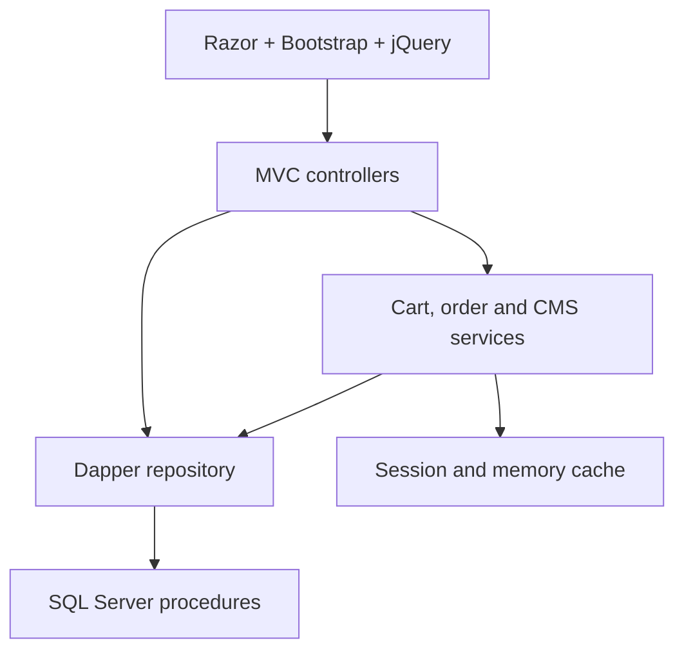
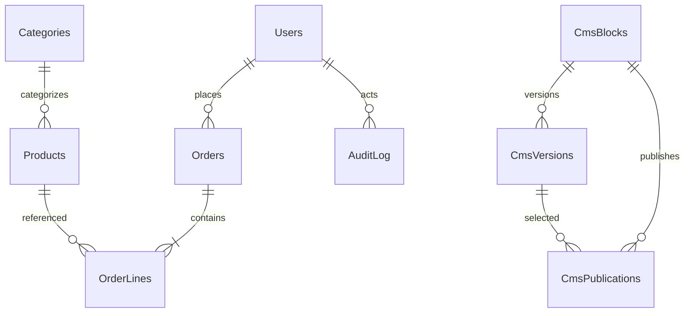

# StorefrontCMS — full source

## Assumptions
1. .NET 10 LTS and SQL Server 2022 Developer with Docker as the primary local run path.
2. One application instance with small cookie authentication and session carts.
3. Mock payment only, prices in INR, no card data or shipping workflow.
4. Product deletion is soft deletion; orders preserve price/name snapshots.
5. CMS renders encoded plain text and keeps immutable versions.
6. SQL runtime and benchmark results are unmeasured here; see EXECUTION_REPORT.md.

## Folder structure

```text
.dockerignore
.env.example
.gitattributes
.gitignore
Dockerfile
EXECUTION_REPORT.md
INTERVIEW_NOTES.md
LICENSE
README.md
RESUME_BULLETS.md
StorefrontCMS.slnx
database/benchmark.sql
database/init.sh
database/order-tests.sql
database/procedures.sql
database/schema.sql
database/seed.sql
docker-compose.yml
docs/RUNBOOK.md
docs/sql-syntax-output.txt
docs/test-output.txt
scripts/setup.ps1
scripts/setup.sh
scripts/sql.ps1
scripts/sql.sh
src/StorefrontCMS/Controllers/AccountController.cs
src/StorefrontCMS/Controllers/AdminController.cs
src/StorefrontCMS/Controllers/CartController.cs
src/StorefrontCMS/Controllers/CatalogController.cs
src/StorefrontCMS/Controllers/OrdersController.cs
src/StorefrontCMS/Data/StoreRepository.cs
src/StorefrontCMS/Models/Models.cs
src/StorefrontCMS/Program.cs
src/StorefrontCMS/Services/CartService.cs
src/StorefrontCMS/Services/CmsService.cs
src/StorefrontCMS/Services/OrderService.cs
src/StorefrontCMS/StorefrontCMS.csproj
src/StorefrontCMS/Views/Account/Login.cshtml
src/StorefrontCMS/Views/Admin/Cms.cshtml
src/StorefrontCMS/Views/Admin/Draft.cshtml
src/StorefrontCMS/Views/Admin/Edit.cshtml
src/StorefrontCMS/Views/Admin/Products.cshtml
src/StorefrontCMS/Views/Cart/Index.cshtml
src/StorefrontCMS/Views/Catalog/Details.cshtml
src/StorefrontCMS/Views/Catalog/Index.cshtml
src/StorefrontCMS/Views/Catalog/Page.cshtml
src/StorefrontCMS/Views/Orders/Checkout.cshtml
src/StorefrontCMS/Views/Orders/Details.cshtml
src/StorefrontCMS/Views/Orders/Index.cshtml
src/StorefrontCMS/Views/Shared/_Layout.cshtml
src/StorefrontCMS/Views/_ViewImports.cshtml
src/StorefrontCMS/Views/_ViewStart.cshtml
src/StorefrontCMS/wwwroot/css/site.css
src/StorefrontCMS/wwwroot/js/cart.js
tests/StorefrontCMS.Tests/CheckoutValidationTests.cs
tests/StorefrontCMS.Tests/OrderServiceTests.cs
tests/StorefrontCMS.Tests/StorefrontCMS.Tests.csproj
tools/SqlSyntaxCheck/Program.cs
tools/SqlSyntaxCheck/SqlSyntaxCheck.csproj
ALL_FILES.md
```

## Complete files in copy order

Each heading is a destination path. All source contents are included without omitted sections. README, runbook and interview notes follow the application files and Compose configuration.

### .dockerignore

````text
**/bin
**/obj
.git
.env

````

### .env.example

````text
# Run scripts/setup.ps1 or scripts/setup.sh to generate .env.
# Required keys: SQL_PASSWORD, CUSTOMER_PASSWORD, ADMIN_PASSWORD.
# Values are intentionally not stored in this repository.

````

### .gitattributes

````text
* text=auto
*.sh text eol=lf
*.sql text eol=lf
Dockerfile text eol=lf

````

### .gitignore

````text
**/bin/
**/obj/
.vs/
.env
TestResults/
benchmark-results.txt

````

### Dockerfile

````text
FROM mcr.microsoft.com/dotnet/sdk:10.0 AS build
WORKDIR /source
COPY . .
RUN dotnet restore StorefrontCMS.slnx
RUN dotnet test StorefrontCMS.slnx -c Release --no-restore
RUN dotnet publish src/StorefrontCMS -c Release --no-restore -o /app
FROM mcr.microsoft.com/dotnet/aspnet:10.0
WORKDIR /app
COPY --from=build /app .
ENV ASPNETCORE_HTTP_PORTS=8080
ENTRYPOINT ["dotnet","StorefrontCMS.dll"]

````

### EXECUTION_REPORT.md

````markdown
# Execution report

Date: 7 November 2026. .NET SDK 10.0.403 on Linux.

| Check | Status | Evidence |
|---|---|---|
| Restore, Release build and Razor compilation | PASSED | Final dotnet test built both projects without reported warnings |
| xUnit | PASSED | 14 passed, 0 failed, 0 skipped; docs/test-output.txt |
| SQL Server 2022 syntax parsing | PASSED | All five SQL files; docs/sql-syntax-output.txt |
| JavaScript syntax | PASSED | node --check src/StorefrontCMS/wwwroot/js/cart.js |
| Bash syntax | PASSED | bash -n scripts/setup.sh scripts/sql.sh database/init.sh |
| Compose YAML parsing | PASSED | Python PyYAML parsed db, init and app services; not Docker validation |
| Docker build/Compose startup | NOT EXECUTED HERE | No Docker executable/daemon available |
| SQL order procedure execution | NOT EXECUTED HERE | No SQL Server available |
| SQL benchmark before/after | NOT EXECUTED HERE | No SQL Server available; no timings claimed |
| Browser flow/security/concurrency checks | NOT EXECUTED HERE | Application cannot start without SQL Server |
| PowerShell script execution | NOT EXECUTED HERE | PowerShell not available; intended for PowerShell 7 |

Exact final test command, with the locally installed SDK on PATH:

```sh
dotnet test StorefrontCMS.slnx -c Release -m:1 -p:UseSharedCompilation=false --nologo
```

The initial parallel MSBuild invocation failed because its named-pipe socket creation was denied. Single-process MSBuild with compiler-server sharing disabled completed successfully. Initial restore flagged two advisories against transitive System.Security.Cryptography.Pkcs 9.0.4; an explicit 10.0.14 reference removed those warnings in the final restore. This is not a claim that the application has received a full security audit.

Reproduce the SQL parser check:

```sh
dotnet run --project tools/SqlSyntaxCheck -- database
```

The parser uses Microsoft's ScriptDom TSql160Parser. It checks grammar, not stored-procedure execution, schema binding, query plans, transaction semantics or concurrency. It caught an invalid combined table-variable declaration, which was corrected before the final check.

To execute the missing SQL checks after starting Compose:

```powershell
pwsh -File scripts/sql.ps1 order-tests
pwsh -File scripts/sql.ps1 benchmark | Tee-Object benchmark-results.txt
```

The benchmark requirement is not fully met until real before/after results are captured and inserted into README. A source review, unit test or syntax parse cannot substitute for those measurements.

````

### LICENSE

````text
MIT License

Copyright (c) 2026 StorefrontCMS contributors

Permission is hereby granted, free of charge, to any person obtaining a copy
of this software and associated documentation files (the "Software"), to deal
in the Software without restriction, including without limitation the rights
to use, copy, modify, merge, publish, distribute, sublicense, and/or sell
copies of the Software, and to permit persons to whom the Software is
furnished to do so, subject to the following conditions:

The above copyright notice and this permission notice shall be included in all
copies or substantial portions of the Software.

THE SOFTWARE IS PROVIDED "AS IS", WITHOUT WARRANTY OF ANY KIND, EXPRESS OR
IMPLIED, INCLUDING BUT NOT LIMITED TO THE WARRANTIES OF MERCHANTABILITY,
FITNESS FOR A PARTICULAR PURPOSE AND NONINFRINGEMENT. IN NO EVENT SHALL THE
AUTHORS OR COPYRIGHT HOLDERS BE LIABLE FOR ANY CLAIM, DAMAGES OR OTHER
LIABILITY, WHETHER IN AN ACTION OF CONTRACT, TORT OR OTHERWISE, ARISING FROM,
OUT OF OR IN CONNECTION WITH THE SOFTWARE OR THE USE OR OTHER DEALINGS IN THE
SOFTWARE.

````

### StorefrontCMS.slnx

````xml
<Solution><Project Path="src/StorefrontCMS/StorefrontCMS.csproj"/><Project Path="tests/StorefrontCMS.Tests/StorefrontCMS.Tests.csproj"/></Solution>

````

### database/benchmark.sql

````sql
USE StorefrontCMS;
GO
SET NOCOUNT ON;
-- Isolated table: does not pollute the 200-product catalog. Never run on production.
IF OBJECT_ID('dbo.SearchBenchmark') IS NOT NULL DROP TABLE dbo.SearchBenchmark;
CREATE TABLE dbo.SearchBenchmark(Id int NOT NULL PRIMARY KEY,CategoryId int NOT NULL,Name nvarchar(120) NOT NULL,Price decimal(12,2) NOT NULL,Padding char(400) NOT NULL);
;WITH n AS (SELECT TOP(200000) ROW_NUMBER() OVER(ORDER BY (SELECT NULL)) i FROM sys.all_objects a CROSS JOIN sys.all_objects b)
INSERT dbo.SearchBenchmark SELECT i,1+i%100,CONCAT('Product ',RIGHT('000000'+CONVERT(varchar(6),i),6)),100,'x' FROM n;
DECLARE @Before bigint,@After bigint,@Start datetime2,@i int=0,@Sink decimal(20,2);
-- Identical, sargable search workload. The deliberately missing covering index
-- makes the before phase scan wide rows. Warm cache and 30 repetitions per phase.
SELECT @Sink=SUM(Price) FROM dbo.SearchBenchmark WHERE CategoryId=42 AND Name LIKE 'Product 1%';
SET STATISTICS IO ON;SET STATISTICS TIME ON;
SET @Start=SYSUTCDATETIME();
WHILE @i<30 BEGIN
 SELECT @Sink=SUM(Price) FROM dbo.SearchBenchmark WHERE CategoryId=42 AND Name LIKE 'Product 1%';
 SET @i+=1;
END;
SET @Before=DATEDIFF_BIG(microsecond,@Start,SYSUTCDATETIME());
CREATE INDEX IX_SearchBenchmark_Category_Name ON dbo.SearchBenchmark(CategoryId,Name) INCLUDE(Price);
SELECT @Sink=SUM(Price) FROM dbo.SearchBenchmark WHERE CategoryId=42 AND Name LIKE 'Product 1%';
SET @i=0;SET @Start=SYSUTCDATETIME();
WHILE @i<30 BEGIN
 SELECT @Sink=SUM(Price) FROM dbo.SearchBenchmark WHERE CategoryId=42 AND Name LIKE 'Product 1%';
 SET @i+=1;
END;
SET @After=DATEDIFF_BIG(microsecond,@Start,SYSUTCDATETIME());
SET STATISTICS IO OFF;SET STATISTICS TIME OFF;
SELECT @@VERSION AS SqlVersion,COUNT(*) AS RowsInFixture FROM dbo.SearchBenchmark;
SELECT CAST(@Before/30000.0 AS decimal(18,3)) AS BeforeMeanMs,CAST(@After/30000.0 AS decimal(18,3)) AS AfterMeanMs,30 AS RepetitionsPerPhase,@Sink AS ResultChecksum;
DROP TABLE dbo.SearchBenchmark;
GO

````

### database/init.sh

````bash
#!/usr/bin/env bash
set -euo pipefail
sql=/opt/mssql-tools18/bin/sqlcmd
exists=$($sql -S db -U sa -C -h -1 -W -Q "SET NOCOUNT ON; SELECT CASE WHEN DB_ID('StorefrontCMS') IS NULL THEN 0 ELSE 1 END" -b)
if [[ "$exists" == *1* ]]; then
  echo 'Database exists; leaving data intact. For a clean demo reset, see README.'
else
  for script in schema seed procedures; do
    $sql -S db -U sa -C -b -i "/scripts/$script.sql"
  done
fi

````

### database/order-tests.sql

````sql
USE StorefrontCMS;
GO
SET NOCOUNT ON;
SET XACT_ABORT ON;
-- Disposable local database only. Dedicated fixtures avoid altering seed products.
DECLARE @Code int,@User int,@Product int,@Other int,@Category int=(SELECT MIN(Id) FROM dbo.Categories),@Key uniqueidentifier=NEWID(),@Correlation varchar(64)='sql-test-'+CONVERT(varchar(36),NEWID());
INSERT dbo.Users(Username,PasswordHash,Role) VALUES(CONCAT('test-',NEWID()),'not-a-login-hash','Customer'); SET @User=SCOPE_IDENTITY();
INSERT dbo.Products(CategoryId,Name,Description,Price,Stock) VALUES(@Category,'Test A','Test fixture',10,5); SET @Product=SCOPE_IDENTITY();
INSERT dbo.Products(CategoryId,Name,Description,Price,Stock) VALUES(@Category,'Test B','Test fixture',20,1); SET @Other=SCOPE_IDENTITY();
DECLARE @Items dbo.CartTable;
DECLARE @Result TABLE(Code int,OrderId int);
BEGIN TRY
 INSERT @Items VALUES(@Product,2);
 INSERT @Result EXEC dbo.PlaceOrder @User,@Key,@Items,@Correlation;
 IF NOT EXISTS(SELECT 1 FROM @Result WHERE Code=0 AND OrderId IS NOT NULL) THROW 52000,'Success result failed',1;
 IF (SELECT Stock FROM dbo.Products WHERE Id=@Product)<>3 THROW 52000,'Stock decrement failed',1;
 IF (SELECT Total FROM dbo.Orders WHERE UserId=@User)<>20 THROW 52000,'Server price failed',1;
 IF (SELECT COUNT(*) FROM dbo.AuditLog WHERE UserId=@User)<>1 THROW 52000,'Order audit failed',1;
 DELETE @Result;
 INSERT @Result EXEC dbo.PlaceOrder @User,@Key,@Items,@Correlation;
 IF (SELECT COUNT(*) FROM dbo.Orders WHERE UserId=@User)<>1 OR (SELECT Stock FROM dbo.Products WHERE Id=@Product)<>3 THROW 52000,'Idempotent retry failed',1;
 DELETE @Items; INSERT @Items VALUES(@Product,1),(@Other,2); SET @Key=NEWID();
 -- A procedure ROLLBACK cannot execute inside INSERT EXEC. Capture its result
 -- directly and assert state separately for rejected orders.
 EXEC @Code=dbo.PlaceOrder @User,@Key,@Items,@Correlation;
 IF @Code<>1 THROW 52000,'Expected insufficient-stock code 1',1;
 IF (SELECT Stock FROM dbo.Products WHERE Id=@Product)<>3 OR (SELECT Stock FROM dbo.Products WHERE Id=@Other)<>1 THROW 52000,'Insufficient-stock rollback failed',1;
 IF (SELECT COUNT(*) FROM dbo.Orders WHERE UserId=@User)<>1 OR (SELECT COUNT(*) FROM dbo.AuditLog WHERE UserId=@User)<>1 THROW 52000,'Rejected order left data',1;
 DELETE @Items; INSERT @Items VALUES(@Product,0); SET @Key=NEWID();
 EXEC @Code=dbo.PlaceOrder @User,@Key,@Items,@Correlation;
 IF @Code<>2 THROW 52000,'Expected invalid-cart code 2',1;
 IF EXISTS(SELECT 1 FROM dbo.Orders WHERE UserId=@User AND RequestId=@Key) THROW 52000,'Invalid quantity accepted',1;
 DELETE @Items; SET @Key=NEWID(); EXEC @Code=dbo.PlaceOrder @User,@Key,@Items,@Correlation;
 IF @Code<>2 THROW 52000,'Expected invalid-cart code 2',1;
 IF EXISTS(SELECT 1 FROM dbo.Orders WHERE UserId=@User AND RequestId=@Key) THROW 52000,'Empty cart accepted',1;
 PRINT 'PASS: success, price, stock, audit, idempotency, rollback, invalid quantity, empty cart';
END TRY
BEGIN CATCH
 DELETE dbo.AuditLog WHERE UserId=@User;
 DELETE l FROM dbo.OrderLines l JOIN dbo.Orders o ON o.Id=l.OrderId WHERE o.UserId=@User;
 DELETE dbo.Orders WHERE UserId=@User;DELETE dbo.Products WHERE Id IN (@Product,@Other);DELETE dbo.Users WHERE Id=@User;
 THROW;
END CATCH;
DELETE dbo.AuditLog WHERE UserId=@User;
DELETE l FROM dbo.OrderLines l JOIN dbo.Orders o ON o.Id=l.OrderId WHERE o.UserId=@User;
DELETE dbo.Orders WHERE UserId=@User;DELETE dbo.Products WHERE Id IN (@Product,@Other);DELETE dbo.Users WHERE Id=@User;
GO

````

### database/procedures.sql

````sql
USE StorefrontCMS;
GO
CREATE OR ALTER PROCEDURE dbo.ProductSearch @Q nvarchar(120)=NULL,@CategoryId int=NULL,@Page int=1 AS
BEGIN
 SET NOCOUNT ON;
 IF @Page<1 OR @Page>100000 THROW 51001,'Invalid page.',1;
 -- Escape LIKE metacharacters: search is a literal substring, not a pattern API.
 DECLARE @Pattern nvarchar(500)=N'%'+REPLACE(REPLACE(REPLACE(REPLACE(ISNULL(@Q,N''),N'~',N'~~'),N'%',N'~%'),N'_',N'~_'),N'[',N'~[')+N'%';
 SELECT * FROM dbo.Products WHERE Active=1 AND (@CategoryId IS NULL OR CategoryId=@CategoryId) AND (@Q IS NULL OR Name LIKE @Pattern ESCAPE '~') ORDER BY Name,Id OFFSET (@Page-1)*12 ROWS FETCH NEXT 12 ROWS ONLY OPTION(RECOMPILE);
 SELECT COUNT(*) FROM dbo.Products WHERE Active=1 AND (@CategoryId IS NULL OR CategoryId=@CategoryId) AND (@Q IS NULL OR Name LIKE @Pattern ESCAPE '~') OPTION(RECOMPILE);
END;
GO
CREATE OR ALTER PROCEDURE dbo.ProductGet @Id int AS
 SELECT * FROM dbo.Products WHERE Id=@Id AND Active=1;
GO
CREATE OR ALTER PROCEDURE dbo.CategoryList AS SELECT Id,Name FROM dbo.Categories ORDER BY Name;
GO
CREATE OR ALTER PROCEDURE dbo.ProductSave @Id int,@CategoryId int,@Name nvarchar(120),@Description nvarchar(2000),@Price decimal(12,2),@Stock int,@Version bigint AS
BEGIN
 SET NOCOUNT ON;
 IF @Id=0 INSERT dbo.Products(CategoryId,Name,Description,Price,Stock) VALUES(@CategoryId,@Name,@Description,@Price,@Stock);
 ELSE BEGIN
 UPDATE dbo.Products SET CategoryId=@CategoryId,Name=@Name,Description=@Description,Price=@Price,Stock=@Stock,Version=Version+1 WHERE Id=@Id AND Active=1 AND Version=@Version;
 IF @@ROWCOUNT=0 THROW 51003,'Product changed; reload before editing.',1;
 END
END;
GO
CREATE OR ALTER PROCEDURE dbo.ProductDelete @Id int,@Version bigint AS
BEGIN
 UPDATE dbo.Products SET Active=0,Version=Version+1 WHERE Id=@Id AND Version=@Version AND Active=1;
 IF @@ROWCOUNT=0 THROW 51003,'Product changed; reload before deleting.',1;
END;
GO
CREATE OR ALTER PROCEDURE dbo.UserGet @Username nvarchar(80) AS SELECT * FROM dbo.Users WHERE Username=@Username;
GO
CREATE OR ALTER PROCEDURE dbo.UserBootstrap @Username nvarchar(80),@PasswordHash nvarchar(500),@Role varchar(10) AS
BEGIN
 SET XACT_ABORT ON;
 BEGIN TRAN;
 IF NOT EXISTS(SELECT 1 FROM dbo.Users WITH(UPDLOCK,HOLDLOCK) WHERE Username=@Username)
 INSERT dbo.Users(Username,PasswordHash,Role) VALUES(@Username,@PasswordHash,@Role);
 COMMIT;
END;
GO
CREATE OR ALTER PROCEDURE dbo.PlaceOrder @UserId int,@RequestId uniqueidentifier,@Items dbo.CartTable READONLY,@CorrelationId varchar(64) AS
BEGIN
 SET NOCOUNT ON; SET XACT_ABORT ON;
 DECLARE @OrderId int,@ProductId int,@Quantity int,@Stock int,@Price decimal(12,2),@Name nvarchar(120);
 DECLARE @Locked TABLE(ProductId int PRIMARY KEY,Quantity int,Name nvarchar(120),Price decimal(12,2));
 BEGIN TRY
 BEGIN TRAN;
 -- Serializes retries for the same customer/request using the unique index range.
 SELECT @OrderId=Id FROM dbo.Orders WITH(UPDLOCK,HOLDLOCK) WHERE UserId=@UserId AND RequestId=@RequestId;
 IF @OrderId IS NOT NULL BEGIN COMMIT; SELECT 0 Code,@OrderId OrderId; RETURN; END;
 IF NOT EXISTS(SELECT 1 FROM @Items) OR (SELECT COUNT(*) FROM @Items)>50 OR EXISTS(SELECT 1 FROM @Items WHERE Quantity<1 OR Quantity>99)
 BEGIN ROLLBACK; SELECT 2 Code,CAST(NULL AS int) OrderId; RETURN 2; END;
 -- Consistent lock order lowers deadlock risk. Locks are retained through commit.
 DECLARE inventory CURSOR LOCAL FAST_FORWARD FOR SELECT ProductId,Quantity FROM @Items ORDER BY ProductId;
 OPEN inventory; FETCH NEXT FROM inventory INTO @ProductId,@Quantity;
 WHILE @@FETCH_STATUS=0
 BEGIN
 SET @Stock=NULL;
 SELECT @Stock=Stock,@Price=Price,@Name=Name FROM dbo.Products WITH(UPDLOCK,HOLDLOCK,ROWLOCK) WHERE Id=@ProductId AND Active=1;
 IF @Stock IS NULL OR @Stock<@Quantity
 BEGIN CLOSE inventory; DEALLOCATE inventory; ROLLBACK; SELECT 1 Code,CAST(NULL AS int) OrderId; RETURN 1; END;
 INSERT @Locked VALUES(@ProductId,@Quantity,@Name,@Price);
 FETCH NEXT FROM inventory INTO @ProductId,@Quantity;
 END;
 CLOSE inventory; DEALLOCATE inventory;
 INSERT dbo.Orders(UserId,RequestId,Total) SELECT @UserId,@RequestId,SUM(Quantity*Price) FROM @Locked;
 SET @OrderId=SCOPE_IDENTITY();
 INSERT dbo.OrderLines(OrderId,ProductId,Name,Quantity,UnitPrice) SELECT @OrderId,ProductId,Name,Quantity,Price FROM @Locked;
 UPDATE p SET Stock=Stock-l.Quantity,Version=Version+1 FROM dbo.Products p JOIN @Locked l ON p.Id=l.ProductId;
 INSERT dbo.AuditLog(Event,UserId,Entity,CorrelationId) VALUES('OrderPlaced',@UserId,CONVERT(nvarchar(80),@OrderId),@CorrelationId);
 COMMIT; SELECT 0 Code,@OrderId OrderId;
 END TRY
 BEGIN CATCH
 IF XACT_STATE()<>0 ROLLBACK;
 THROW;
 END CATCH;
END;
GO
CREATE OR ALTER PROCEDURE dbo.OrderHistory @UserId int AS
 SELECT TOP(100) Id,CreatedUtc,Total FROM dbo.Orders WHERE UserId=@UserId ORDER BY CreatedUtc DESC,Id DESC;
GO
CREATE OR ALTER PROCEDURE dbo.OrderDetail @UserId int,@Id int AS
BEGIN
 SELECT Id,CreatedUtc,Total FROM dbo.Orders WHERE Id=@Id AND UserId=@UserId;
 SELECT l.Name,l.Quantity,l.UnitPrice FROM dbo.OrderLines l JOIN dbo.Orders o ON o.Id=l.OrderId WHERE o.Id=@Id AND o.UserId=@UserId ORDER BY l.ProductId;
END;
GO
CREATE OR ALTER PROCEDURE dbo.CmsPublished @Slug varchar(40) AS
 SELECT v.* FROM dbo.CmsBlocks b JOIN dbo.CmsVersions v ON v.Id=b.PublishedVersionId WHERE b.Slug=@Slug;
GO
CREATE OR ALTER PROCEDURE dbo.CmsList AS
BEGIN SELECT * FROM dbo.CmsBlocks ORDER BY Slug; SELECT * FROM dbo.CmsVersions ORDER BY Id DESC; END;
GO
CREATE OR ALTER PROCEDURE dbo.CmsDraft @Slug varchar(40),@Title nvarchar(120),@Body nvarchar(4000) AS
BEGIN
 SET XACT_ABORT ON;
 BEGIN TRAN;
 IF NOT EXISTS(SELECT 1 FROM dbo.CmsBlocks WITH(UPDLOCK,HOLDLOCK) WHERE Slug=@Slug) INSERT dbo.CmsBlocks(Slug) VALUES(@Slug);
 INSERT dbo.CmsVersions(Slug,Title,Body) VALUES(@Slug,@Title,@Body);
 COMMIT;
END;
GO
CREATE OR ALTER PROCEDURE dbo.CmsPublish @Slug varchar(40),@VersionId int,@UserId int,@CorrelationId varchar(64) AS
BEGIN
 SET XACT_ABORT ON;
 BEGIN TRY
 BEGIN TRAN;
 DECLARE @Current int;
 SELECT @Current=PublishedVersionId FROM dbo.CmsBlocks WITH(UPDLOCK,HOLDLOCK) WHERE Slug=@Slug;
 IF NOT EXISTS(SELECT 1 FROM dbo.CmsVersions WHERE Id=@VersionId AND Slug=@Slug) THROW 51004,'Version does not belong to block.',1;
 IF @Current IS NULL OR @Current<>@VersionId
 BEGIN
 UPDATE dbo.CmsBlocks SET PublishedVersionId=@VersionId WHERE Slug=@Slug;
 INSERT dbo.CmsPublications(Slug,VersionId) VALUES(@Slug,@VersionId);
 INSERT dbo.AuditLog(Event,UserId,Entity,CorrelationId) VALUES('CmsPublished',@UserId,@Slug,@CorrelationId);
 END;
 COMMIT;
 END TRY BEGIN CATCH IF XACT_STATE()<>0 ROLLBACK; THROW; END CATCH;
END;
GO
CREATE OR ALTER PROCEDURE dbo.CmsRollback @Slug varchar(40),@UserId int,@CorrelationId varchar(64) AS
BEGIN
 SET XACT_ABORT ON;
 BEGIN TRY
 BEGIN TRAN;
 DECLARE @Current int,@Previous int;
 SELECT @Current=PublishedVersionId FROM dbo.CmsBlocks WITH(UPDLOCK,HOLDLOCK) WHERE Slug=@Slug;
 SELECT TOP(1) @Previous=VersionId FROM dbo.CmsPublications WHERE Slug=@Slug AND VersionId<>@Current ORDER BY Id DESC;
 IF @Previous IS NULL THROW 51005,'No previous published version.',1;
 UPDATE dbo.CmsBlocks SET PublishedVersionId=@Previous WHERE Slug=@Slug;
 INSERT dbo.CmsPublications(Slug,VersionId) VALUES(@Slug,@Previous);
 INSERT dbo.AuditLog(Event,UserId,Entity,CorrelationId) VALUES('CmsRolledBack',@UserId,@Slug,@CorrelationId);
 COMMIT;
 END TRY BEGIN CATCH IF XACT_STATE()<>0 ROLLBACK; THROW; END CATCH;
END;
GO
CREATE OR ALTER PROCEDURE dbo.HealthCheck AS SELECT 1 FROM dbo.Categories;
GO

````

### database/schema.sql

````sql
IF DB_ID('StorefrontCMS') IS NULL CREATE DATABASE StorefrontCMS;
GO
USE StorefrontCMS;
GO
IF OBJECT_ID('dbo.Products') IS NOT NULL THROW 51000, 'Schema already exists; use a fresh database.', 1;
CREATE TABLE dbo.Categories(Id int IDENTITY PRIMARY KEY,Name nvarchar(80) NOT NULL UNIQUE);
CREATE TABLE dbo.Products(Id int IDENTITY PRIMARY KEY,CategoryId int NOT NULL REFERENCES dbo.Categories(Id),Name nvarchar(120) NOT NULL,Description nvarchar(2000) NOT NULL,Price decimal(12,2) NOT NULL CHECK(Price>0),Stock int NOT NULL CHECK(Stock>=0),Active bit NOT NULL DEFAULT 1,Version bigint NOT NULL DEFAULT 1);
CREATE INDEX IX_Products_Category_Name ON dbo.Products(CategoryId,Name,Id) INCLUDE(Price,Stock) WHERE Active=1;
CREATE TABLE dbo.Users(Id int IDENTITY PRIMARY KEY,Username nvarchar(80) NOT NULL UNIQUE,PasswordHash nvarchar(500) NOT NULL,Role varchar(10) NOT NULL CHECK(Role IN ('Customer','Admin')));
CREATE TABLE dbo.Orders(Id int IDENTITY PRIMARY KEY,UserId int NOT NULL REFERENCES dbo.Users(Id),RequestId uniqueidentifier NOT NULL,CreatedUtc datetime2 NOT NULL DEFAULT SYSUTCDATETIME(),Total decimal(14,2) NOT NULL,CONSTRAINT UQ_Order_Request UNIQUE(UserId,RequestId));
CREATE INDEX IX_Orders_User_Created ON dbo.Orders(UserId,CreatedUtc DESC) INCLUDE(Total);
CREATE TABLE dbo.OrderLines(OrderId int NOT NULL REFERENCES dbo.Orders(Id),ProductId int NOT NULL REFERENCES dbo.Products(Id),Name nvarchar(120) NOT NULL,Quantity int NOT NULL CHECK(Quantity>0),UnitPrice decimal(12,2) NOT NULL,PRIMARY KEY(OrderId,ProductId));
CREATE TABLE dbo.CmsBlocks(Slug varchar(40) PRIMARY KEY,PublishedVersionId int NULL);
CREATE TABLE dbo.CmsVersions(Id int IDENTITY PRIMARY KEY,Slug varchar(40) NOT NULL REFERENCES dbo.CmsBlocks(Slug),Title nvarchar(120) NOT NULL,Body nvarchar(4000) NOT NULL,CreatedUtc datetime2 NOT NULL DEFAULT SYSUTCDATETIME());
ALTER TABLE dbo.CmsBlocks ADD CONSTRAINT FK_Cms_Published FOREIGN KEY(PublishedVersionId) REFERENCES dbo.CmsVersions(Id);
CREATE TABLE dbo.CmsPublications(Id int IDENTITY PRIMARY KEY,Slug varchar(40) NOT NULL REFERENCES dbo.CmsBlocks(Slug),VersionId int NOT NULL REFERENCES dbo.CmsVersions(Id),CreatedUtc datetime2 NOT NULL DEFAULT SYSUTCDATETIME());
CREATE INDEX IX_CmsPublications_Slug_Id ON dbo.CmsPublications(Slug,Id DESC) INCLUDE(VersionId);
CREATE TABLE dbo.AuditLog(Id bigint IDENTITY PRIMARY KEY,Event varchar(40) NOT NULL,UserId int NOT NULL REFERENCES dbo.Users(Id),Entity nvarchar(80) NOT NULL,CorrelationId varchar(64) NOT NULL,CreatedUtc datetime2 NOT NULL DEFAULT SYSUTCDATETIME());
CREATE TYPE dbo.CartTable AS TABLE(ProductId int PRIMARY KEY,Quantity int NOT NULL);
GO

````

### database/seed.sql

````sql
USE StorefrontCMS;
GO
INSERT dbo.Categories(Name) VALUES(N'Electronics'),(N'Home'),(N'Books'),(N'Clothing');
;WITH n AS (SELECT 1 i UNION ALL SELECT i+1 FROM n WHERE i<200)
INSERT dbo.Products(CategoryId,Name,Description,Price,Stock)
SELECT (i-1)%4+1,CONCAT(N'Product ',RIGHT('000'+CAST(i AS varchar(3)),3)),CONCAT(N'Practical demonstration item ',i,N'. Seed data, not a real listing.'),CAST(99+i*7.25 AS decimal(12,2)),10+i%30 FROM n OPTION(MAXRECURSION 200);
INSERT dbo.CmsBlocks(Slug) VALUES('homepage-banner'),('promo-strip'),('about');
INSERT dbo.CmsVersions(Slug,Title,Body) VALUES('homepage-banner',N'Small store. Clear choices.',N'Explore our demonstration catalog and try a mock checkout.'),('promo-strip',N'Practice store',N'No real payments or shipments.'),('about',N'About StorefrontCMS',N'A student-built storefront with transactional inventory and versioned content.');
UPDATE b SET PublishedVersionId=v.Id FROM dbo.CmsBlocks b JOIN dbo.CmsVersions v ON v.Slug=b.Slug;
INSERT dbo.CmsPublications(Slug,VersionId) SELECT Slug,PublishedVersionId FROM dbo.CmsBlocks;
GO

````

### docs/sql-syntax-output.txt

````text
PASS SQL Server 2022 syntax: seed.sql
PASS SQL Server 2022 syntax: schema.sql
PASS SQL Server 2022 syntax: procedures.sql
PASS SQL Server 2022 syntax: benchmark.sql
PASS SQL Server 2022 syntax: order-tests.sql

````

### docs/test-output.txt

````text
  Determining projects to restore...
  Restored /workspace/scratch/431c86819958/StorefrontCMS/src/StorefrontCMS/StorefrontCMS.csproj (in 8.74 sec).
  Restored /workspace/scratch/431c86819958/StorefrontCMS/tests/StorefrontCMS.Tests/StorefrontCMS.Tests.csproj (in 8.74 sec).
  StorefrontCMS -> /workspace/scratch/431c86819958/StorefrontCMS/src/StorefrontCMS/bin/Release/net10.0/StorefrontCMS.dll
  StorefrontCMS.Tests -> /workspace/scratch/431c86819958/StorefrontCMS/tests/StorefrontCMS.Tests/bin/Release/net10.0/StorefrontCMS.Tests.dll
Test run for /workspace/scratch/431c86819958/StorefrontCMS/tests/StorefrontCMS.Tests/bin/Release/net10.0/StorefrontCMS.Tests.dll (.NETCoreApp,Version=v10.0)
A total of 1 test files matched the specified pattern.

Passed!  - Failed:     0, Passed:    14, Skipped:     0, Total:    14, Duration: 87 ms - StorefrontCMS.Tests.dll (net10.0)

````

### scripts/setup.ps1

````powershell
$ErrorActionPreference = 'Stop'
if (Test-Path .env) { throw '.env already exists. Preserve your existing credentials.' }
function New-Secret { return 'Sc9!' + [Convert]::ToHexString([System.Security.Cryptography.RandomNumberGenerator]::GetBytes(24)) }
@("SQL_PASSWORD=$(New-Secret)", "CUSTOMER_PASSWORD=$(New-Secret)", "ADMIN_PASSWORD=$(New-Secret)") | Set-Content .env
Write-Host 'Created .env. Read it locally for customer/admin passwords; never commit it.'

````

### scripts/setup.sh

````bash
#!/usr/bin/env bash
set -euo pipefail
if [[ -f .env ]]; then echo '.env already exists; preserving credentials.'; exit 1; fi
umask 077
for name in SQL_PASSWORD CUSTOMER_PASSWORD ADMIN_PASSWORD; do
 printf '%s=Sc9!%s\n' "$name" "$(openssl rand -hex 24)" >> .env
done
echo 'Created .env. Read it locally for customer/admin passwords; never commit it.'

````

### scripts/sql.ps1

````powershell
param([ValidateSet('order-tests','benchmark')][string]$Script='order-tests')
$ErrorActionPreference='Stop'
docker compose exec -T db bash -c 'export SQLCMDPASSWORD="$MSSQL_SA_PASSWORD"; exec /opt/mssql-tools18/bin/sqlcmd -S localhost -U sa -C -b -i "$1"' -- "/scripts/$Script.sql"
if ($LASTEXITCODE -ne 0) { throw "SQL script failed: $Script" }

````

### scripts/sql.sh

````bash
#!/usr/bin/env bash
set -euo pipefail
case "${1:-order-tests}" in order-tests|benchmark) script="${1:-order-tests}";; *) echo 'Expected order-tests or benchmark'; exit 1;; esac
docker compose exec -T db bash -c 'export SQLCMDPASSWORD="$MSSQL_SA_PASSWORD"; exec /opt/mssql-tools18/bin/sqlcmd -S localhost -U sa -C -b -i "$1"' -- "/scripts/$script.sql"

````

### src/StorefrontCMS/Controllers/AccountController.cs

````csharp
using System.Security.Claims;
using Microsoft.AspNetCore.Authentication;
using Microsoft.AspNetCore.Authentication.Cookies;
using Microsoft.AspNetCore.Identity;
using Microsoft.AspNetCore.Mvc;
using Microsoft.AspNetCore.RateLimiting;
using StorefrontCMS.Data;
using StorefrontCMS.Models;
namespace StorefrontCMS.Controllers;
public sealed class AccountController(StoreRepository repository):Controller {
 [HttpGet] public IActionResult Login()=>View(new LoginInput());
 [HttpPost,EnableRateLimiting("login")] public async Task<IActionResult> Login(LoginInput input) {
 if(!ModelState.IsValid)return View(input);
 var user=(await repository.Query<StoreUser>("dbo.UserGet",new {input.Username})).SingleOrDefault();
 if(user is null || new PasswordHasher<string>().VerifyHashedPassword(user.Username,user.PasswordHash,input.Password)==PasswordVerificationResult.Failed) {ModelState.AddModelError("","Invalid username or password.");return View(input);}
 var identity=new ClaimsIdentity(new[]{new Claim(ClaimTypes.NameIdentifier,user.Id.ToString()),new Claim(ClaimTypes.Name,user.Username),new Claim(ClaimTypes.Role,user.Role)},CookieAuthenticationDefaults.AuthenticationScheme);
 HttpContext.Session.Clear();
 await HttpContext.SignInAsync(CookieAuthenticationDefaults.AuthenticationScheme,new ClaimsPrincipal(identity)); return RedirectToAction("Index","Catalog");
 }
 [HttpPost] public async Task<IActionResult> Logout(){await HttpContext.SignOutAsync();HttpContext.Session.Clear();return RedirectToAction("Index","Catalog");}
 public IActionResult Denied()=>StatusCode(403,"Administrator access is required.");
}

````

### src/StorefrontCMS/Controllers/AdminController.cs

````csharp
using System.Security.Claims;
using Microsoft.AspNetCore.Authorization;
using Microsoft.AspNetCore.Mvc;
using Microsoft.Data.SqlClient;
using StorefrontCMS.Data;
using StorefrontCMS.Models;
using StorefrontCMS.Services;
namespace StorefrontCMS.Controllers;
[Authorize(Roles="Admin")]
public sealed class AdminController(StoreRepository repository,CmsService cms):Controller {
 public async Task<IActionResult> Products(int page=1) {if(page<1||page>100000)return BadRequest();return View(await repository.Search(null,null,page));}
 [HttpGet] public async Task<IActionResult> Edit(int id=0){ViewBag.Categories=await repository.Query<Category>("dbo.CategoryList");var p=id==0?new Product():await repository.Product(id);return p is null?NotFound():View(p);}
 [HttpPost] public async Task<IActionResult> Edit(Product p) {
 var categories=await repository.Query<Category>("dbo.CategoryList");ViewBag.Categories=categories;
 if(!categories.Any(x=>x.Id==p.CategoryId))ModelState.AddModelError("CategoryId","Choose an existing category.");
 if(!ModelState.IsValid)return View(p);
 try{await repository.Execute("dbo.ProductSave",new {p.Id,p.CategoryId,p.Name,p.Description,p.Price,p.Stock,p.Version});}
 catch(SqlException ex) when(ex.Number==51003){ModelState.AddModelError("",ex.Message);return View(p);}
 return RedirectToAction(nameof(Products));
 }
 [HttpPost] public async Task<IActionResult> Delete(int id,long version){try{await repository.Execute("dbo.ProductDelete",new {Id=id,Version=version});}catch(SqlException ex) when(ex.Number==51003){TempData["Message"]=ex.Message;}return RedirectToAction(nameof(Products));}
 public async Task<IActionResult> Cms()=>View(await repository.CmsList());
 [HttpGet] public async Task<IActionResult> Draft(int? id) {
 var v=id.HasValue?(await repository.CmsList()).Versions.SingleOrDefault(x=>x.Id==id):null;
 if(id.HasValue&&v is null)return NotFound();return View(v is null?new CmsEdit():new CmsEdit {Slug=v.Slug,Title=v.Title,Body=v.Body});
 }
 [HttpPost] public async Task<IActionResult> Draft(CmsEdit input){if(!ModelState.IsValid)return View(input);await repository.Execute("dbo.CmsDraft",new {input.Slug,input.Title,input.Body});return RedirectToAction(nameof(Cms));}
 [HttpPost] public async Task<IActionResult> Publish(string slug,int? versionId){
 if(!ModelState.IsValid || string.IsNullOrEmpty(slug) || slug.Length>40)return BadRequest();
 try{await cms.Publish(slug,versionId,int.Parse(User.FindFirstValue(ClaimTypes.NameIdentifier)!),HttpContext.TraceIdentifier);TempData["Message"]="Publication updated.";}
 catch(SqlException ex) when(ex.Number is 51004 or 51005){TempData["Message"]=ex.Message;}
 return RedirectToAction(nameof(Cms));
 }
}

````

### src/StorefrontCMS/Controllers/CartController.cs

````csharp
using Microsoft.AspNetCore.Mvc;
using StorefrontCMS.Services;
namespace StorefrontCMS.Controllers;
public sealed class CartController(CartService cart):Controller {
 public async Task<IActionResult> Index()=>View(await cart.Items());
 [HttpGet] public async Task<IActionResult> Summary()=>Json(await SummaryData());
 private async Task<object> SummaryData() {var items=await cart.Items();return new {count=items.Sum(x=>x.Quantity),total=items.Sum(x=>x.Total),items=items.Select(x=>new {id=x.Product.Id,name=x.Product.Name,quantity=x.Quantity,total=x.Total})};}
 [HttpPost] public async Task<IActionResult> Set(int productId,int quantity,bool add=false) {
 if(!ModelState.IsValid) return BadRequest(new {error="Invalid cart input."});
 try {await cart.Set(productId,quantity,add);return Json(await SummaryData());}catch(ArgumentException ex){return BadRequest(new {error=ex.Message});}
 }
}

````

### src/StorefrontCMS/Controllers/CatalogController.cs

````csharp
using Microsoft.AspNetCore.Mvc;
using StorefrontCMS.Data;
using StorefrontCMS.Services;
namespace StorefrontCMS.Controllers;
public sealed class CatalogController(StoreRepository repository,CmsService cms):Controller {
 public async Task<IActionResult> Index(string? q,int? categoryId,int page=1) {
 if(page<1 || page>100000 || q?.Length>120) return BadRequest();
 ViewBag.Banner=await cms.Published("homepage-banner");ViewBag.Promo=await cms.Published("promo-strip");
 return View(await repository.Search(string.IsNullOrWhiteSpace(q)?null:q.Trim(),categoryId,page));
 }
 public async Task<IActionResult> Details(int id) {var p=await repository.Product(id);return p is null?NotFound():View(p);}
 public async Task<IActionResult> Page(string slug="about") {var block=await cms.Published(slug);return block is null?NotFound():View(block);}
}

````

### src/StorefrontCMS/Controllers/OrdersController.cs

````csharp
using System.Security.Claims;
using Microsoft.AspNetCore.Authorization;
using Microsoft.AspNetCore.Mvc;
using StorefrontCMS.Data;
using StorefrontCMS.Models;
using StorefrontCMS.Services;
namespace StorefrontCMS.Controllers;
[Authorize]
public sealed class OrdersController(StoreRepository repository,CartService cart,OrderService service):Controller {
 private int UserId=>int.Parse(User.FindFirstValue(ClaimTypes.NameIdentifier)!);
 public async Task<IActionResult> Index()=>View(await repository.Query<OrderSummary>("dbo.OrderHistory",new {UserId}));
 public async Task<IActionResult> Details(int id){var detail=await repository.Detail(UserId,id);return detail is null?NotFound():View(detail);}
 [HttpGet] public IActionResult Checkout() {var key=HttpContext.Session.GetString("checkout");if(key is null){key=Guid.NewGuid().ToString();HttpContext.Session.SetString("checkout",key);}return View(new CheckoutInput {RequestId=Guid.Parse(key)});}
 [HttpPost] public async Task<IActionResult> Checkout(CheckoutInput input) {
 if(!ModelState.IsValid)return View(input);
 if(input.RequestId==Guid.Empty || HttpContext.Session.GetString("checkout")!=input.RequestId.ToString()) return BadRequest("Checkout expired. Open checkout again.");
 var result=await service.Place(UserId,input.RequestId,cart.Read(),HttpContext.TraceIdentifier);
 if(result.Code!=0){ModelState.AddModelError("",result.Code==1?"Stock changed or a product is unavailable. Update your cart and retry.":"Your cart is empty or invalid.");return View(input);}
 cart.Clear();HttpContext.Session.Remove("checkout");return RedirectToAction(nameof(Details),new {id=result.OrderId});
 }
}

````

### src/StorefrontCMS/Data/StoreRepository.cs

````csharp
using System.Data;
using Dapper;
using Microsoft.Data.SqlClient;
using StorefrontCMS.Models;
namespace StorefrontCMS.Data;
public interface IOrderRepository { Task<OrderResult> Place(int userId,Guid requestId,IReadOnlyList<CartLine> items,string correlationId); }
public sealed class StoreRepository(IConfiguration config):IOrderRepository {
 public SqlConnection Open()=>new(config.GetConnectionString("Store") ?? throw new InvalidOperationException("Missing Store connection string."));
 public async Task<List<T>> Query<T>(string procedure,object? args=null) { using var c=Open(); return (await c.QueryAsync<T>(procedure,args,commandType:CommandType.StoredProcedure)).AsList(); }
 public async Task Execute(string procedure,object args) { using var c=Open(); await c.ExecuteAsync(procedure,args,commandType:CommandType.StoredProcedure); }
 public async Task<Catalog> Search(string? q,int? categoryId,int page) {
 using var c=Open(); using var grid=await c.QueryMultipleAsync("dbo.ProductSearch",new {Q=q,CategoryId=categoryId,Page=page},commandType:CommandType.StoredProcedure);
 var products=(await grid.ReadAsync<Product>()).AsList(); var total=await grid.ReadSingleAsync<int>();
 return new(products,await Query<Category>("dbo.CategoryList"),total,page,q,categoryId);
 }
 public async Task<Product?> Product(int id)=>(await Query<Product>("dbo.ProductGet",new {Id=id})).SingleOrDefault();
 public async Task<OrderResult> Place(int userId,Guid requestId,IReadOnlyList<CartLine> items,string correlationId) {
 var table=new DataTable(); table.Columns.Add("ProductId",typeof(int)); table.Columns.Add("Quantity",typeof(int)); foreach(var line in items) table.Rows.Add(line.ProductId,line.Quantity);
 using var c=Open(); return await c.QuerySingleAsync<OrderResult>("dbo.PlaceOrder",new {UserId=userId,RequestId=requestId,Items=table.AsTableValuedParameter("dbo.CartTable"),CorrelationId=correlationId},commandType:CommandType.StoredProcedure);
 }
 public async Task<OrderDetail?> Detail(int userId,int id) {
 using var c=Open(); using var g=await c.QueryMultipleAsync("dbo.OrderDetail",new {UserId=userId,Id=id},commandType:CommandType.StoredProcedure);
 var order=await g.ReadSingleOrDefaultAsync<OrderSummary>(); var lines=(await g.ReadAsync<OrderLine>()).AsList(); return order is null?null:new(order,lines);
 }
 public async Task<CmsScreen> CmsList() {
 using var c=Open(); using var g=await c.QueryMultipleAsync("dbo.CmsList",commandType:CommandType.StoredProcedure);
 return new((await g.ReadAsync<CmsBlock>()).AsList(),(await g.ReadAsync<CmsVersion>()).AsList());
 }
}

````

### src/StorefrontCMS/Models/Models.cs

````csharp
using System.ComponentModel.DataAnnotations;
namespace StorefrontCMS.Models;
public sealed class Product {
 public int Id {get;set;}
 [Range(1,int.MaxValue)] public int CategoryId {get;set;}
 [Required,StringLength(120)] public string Name {get;set;}="";
 [Required,StringLength(2000)] public string Description {get;set;}="";
 [Range(typeof(decimal),"0.01","999999.99")] public decimal Price {get;set;}
 [Range(0,1000000)] public int Stock {get;set;}
 public bool Active {get;set;}=true;
 public long Version {get;set;}
}
public sealed record Category(int Id,string Name);
public sealed record Catalog(IReadOnlyList<Product> Products,IReadOnlyList<Category> Categories,int Total,int Page,string? Q,int? CategoryId);
public sealed record CartLine(int ProductId,int Quantity);
public sealed record CartItem(Product Product,int Quantity) { public decimal Total=>Product.Price*Quantity; }
public sealed record OrderResult(int Code,int? OrderId);
public sealed record OrderSummary(int Id,DateTime CreatedUtc,decimal Total);
public sealed record OrderLine(string Name,int Quantity,decimal UnitPrice);
public sealed record OrderDetail(OrderSummary Order,IReadOnlyList<OrderLine> Lines);
public sealed class CmsEdit {
 [Required,RegularExpression("^[a-z][a-z0-9-]{0,39}$")] public string Slug {get;set;}="";
 [Required,StringLength(120)] public string Title {get;set;}="";
 [Required,StringLength(4000)] public string Body {get;set;}="";
}
public sealed record CmsVersion(int Id,string Slug,string Title,string Body,DateTime CreatedUtc);
public sealed record CmsBlock(string Slug,int? PublishedVersionId);
public sealed record CmsScreen(IReadOnlyList<CmsBlock> Blocks,IReadOnlyList<CmsVersion> Versions);
public sealed class LoginInput {
 [Required,StringLength(80)] public string Username {get;set;}="";
 [Required,StringLength(200),DataType(DataType.Password)] public string Password {get;set;}="";
}
public sealed record StoreUser(int Id,string Username,string PasswordHash,string Role);
public sealed class CheckoutInput { public Guid RequestId {get;set;} [Range(typeof(bool),"true","true",ErrorMessage="Confirm the mock payment.")] public bool Confirm {get;set;} }

````

### src/StorefrontCMS/Program.cs

````csharp
using System.Threading.RateLimiting;
using Microsoft.AspNetCore.Authentication.Cookies;
using Microsoft.AspNetCore.DataProtection;
using Microsoft.AspNetCore.Identity;
using Microsoft.AspNetCore.Mvc;
using StorefrontCMS.Data;
using StorefrontCMS.Models;
using StorefrontCMS.Services;
var builder=WebApplication.CreateBuilder(args);
builder.Logging.ClearProviders(); builder.Logging.AddJsonConsole(o=>o.IncludeScopes=true);
builder.Services.AddControllersWithViews(o=>o.Filters.Add(new AutoValidateAntiforgeryTokenAttribute()));
builder.Services.AddAntiforgery(o=>o.HeaderName="X-CSRF-TOKEN");
builder.Services.AddAuthentication(CookieAuthenticationDefaults.AuthenticationScheme).AddCookie(o=>{
 o.LoginPath="/Account/Login"; o.AccessDeniedPath="/Account/Denied"; o.Cookie.HttpOnly=true; o.Cookie.SameSite=SameSiteMode.Lax; o.ExpireTimeSpan=TimeSpan.FromHours(2);
});
builder.Services.AddAuthorization(); builder.Services.AddDistributedMemoryCache(); builder.Services.AddMemoryCache();
builder.Services.AddSession(o=>{o.Cookie.HttpOnly=true;o.Cookie.IsEssential=true;o.IdleTimeout=TimeSpan.FromHours(2);});
builder.Services.AddHttpContextAccessor();builder.Services.AddSingleton<CmsGate>();
builder.Services.AddScoped<StoreRepository>(); builder.Services.AddScoped<IOrderRepository>(s=>s.GetRequiredService<StoreRepository>());
builder.Services.AddScoped<OrderService>(); builder.Services.AddScoped<CartService>(); builder.Services.AddScoped<CmsService>();
builder.Services.AddRateLimiter(o=>{o.RejectionStatusCode=429;o.AddPolicy("login",ctx=>RateLimitPartition.GetFixedWindowLimiter(ctx.Connection.RemoteIpAddress?.ToString()??"unknown",_=>new FixedWindowRateLimiterOptions {PermitLimit=10,Window=TimeSpan.FromMinutes(1),QueueLimit=0}));});
var keys=builder.Configuration["DataProtectionPath"]; if(!string.IsNullOrEmpty(keys)) builder.Services.AddDataProtection().PersistKeysToFileSystem(new DirectoryInfo(keys));
var app=builder.Build();
app.Use(async(ctx,next)=>{
 var id=Guid.NewGuid().ToString("N");ctx.TraceIdentifier=id;ctx.Response.Headers["X-Correlation-ID"]=id;
 using var scope=app.Logger.BeginScope(new Dictionary<string,object>{{"CorrelationId",id}});
 var timer=System.Diagnostics.Stopwatch.StartNew();
 try {await next();} catch(Exception ex) {
 app.Logger.LogError(ex,"Unhandled request error {Path}",ctx.Request.Path);
 if(ctx.Response.HasStarted) throw;
 ctx.Response.Clear();ctx.Response.StatusCode=500;ctx.Response.Headers["X-Correlation-ID"]=id;
 if(ctx.Request.Headers["X-Requested-With"]=="XMLHttpRequest") await ctx.Response.WriteAsJsonAsync(new {error="Something went wrong. Please retry.",correlationId=id});
 else {ctx.Response.ContentType="text/html; charset=utf-8";await ctx.Response.WriteAsync($"<h1>Something went wrong</h1><p>Please retry. Support reference: {id}</p><a href='/'>Return to store</a>");}
 } finally {app.Logger.LogInformation("HTTP {Method} {Path} returned {Status} in {ElapsedMs} ms",ctx.Request.Method,ctx.Request.Path,ctx.Response.StatusCode,timer.ElapsedMilliseconds);}
});
app.UseStaticFiles(); app.UseRouting(); app.UseRateLimiter(); app.UseSession(); app.UseAuthentication(); app.UseAuthorization();
app.MapGet("/health",async(StoreRepository repository)=>{try {await repository.Query<int>("dbo.HealthCheck");return Results.Json(new {status="healthy"});}catch(Exception ex){app.Logger.LogError(ex,"Database health check failed");return Results.Json(new {status="unhealthy"},statusCode:503);}});
app.MapControllerRoute("default","{controller=Catalog}/{action=Index}/{id?}");
// Provision demo accounts once. Secrets come exclusively from environment/user secrets.
using(var scope=app.Services.CreateScope()) {
 var repo=scope.ServiceProvider.GetRequiredService<StoreRepository>();var hasher=new PasswordHasher<string>();
 foreach(var (name,role,key) in new[]{("customer","Customer","DemoCustomerPassword"),("admin","Admin","DemoAdminPassword")}) {
 var password=builder.Configuration[key]??throw new InvalidOperationException($"Set {key} before starting.");
 if(password.Length<12) throw new InvalidOperationException($"{key} must contain at least 12 characters.");
 await repo.Execute("dbo.UserBootstrap",new {Username=name,PasswordHash=hasher.HashPassword(name,password),Role=role});
 }
}
app.Run();

````

### src/StorefrontCMS/Services/CartService.cs

````csharp
using System.Text.Json;
using StorefrontCMS.Data;
using StorefrontCMS.Models;
namespace StorefrontCMS.Services;
public sealed class CartService(IHttpContextAccessor accessor,StoreRepository repository) {
 private ISession Session=>accessor.HttpContext!.Session;
 public List<CartLine> Read()=>JsonSerializer.Deserialize<List<CartLine>>(Session.GetString("cart")??"[]")!;
 public void Clear()=>Session.Remove("cart");
 public async Task Set(int productId,int quantity,bool add=false) {
 var lines=Read(); var existing=lines.SingleOrDefault(x=>x.ProductId==productId);
 if(add) quantity+=existing?.Quantity??0;
 if(quantity<0 || quantity>99 || productId<=0) throw new ArgumentException("Quantity must be between 0 and 99.");
 if(quantity>0) {
 var product=await repository.Product(productId)??throw new ArgumentException("Product is no longer available.");
 if(product.Stock<quantity) throw new ArgumentException("Not enough stock for this quantity.");
 if(existing is null && lines.Count>=50) throw new ArgumentException("Cart supports at most 50 products.");
 }
 lines.RemoveAll(x=>x.ProductId==productId); if(quantity>0) lines.Add(new(productId,quantity));
 Session.SetString("cart",JsonSerializer.Serialize(lines));
 }
 public async Task<List<CartItem>> Items() {
 var result=new List<CartItem>();
 foreach(var line in Read()) { var p=await repository.Product(line.ProductId); if(p is not null) result.Add(new(p,line.Quantity)); else result.Add(new(new Product {Id=line.ProductId,Name="Unavailable product — remove before checkout",Price=0,Stock=0},line.Quantity)); }
 return result;
 }
}

````

### src/StorefrontCMS/Services/CmsService.cs

````csharp
using Microsoft.Extensions.Caching.Memory;
using StorefrontCMS.Data;
using StorefrontCMS.Models;
namespace StorefrontCMS.Services;
// One gate prevents an in-flight reader from repopulating an old value after publish.
public sealed class CmsGate { public SemaphoreSlim Value {get;}=new(1,1); }
public sealed class CmsService(StoreRepository repository,IMemoryCache cache,CmsGate gate) {
 public async Task<CmsVersion?> Published(string slug) {
 await gate.Value.WaitAsync(); try {
 if(cache.TryGetValue<CmsVersion>("cms:"+slug,out var value)) return value;
 value=(await repository.Query<CmsVersion>("dbo.CmsPublished",new {Slug=slug})).SingleOrDefault();
 if(value is not null) cache.Set("cms:"+slug,value,TimeSpan.FromMinutes(2));
 return value;
 } finally {gate.Value.Release();}
 }
 public async Task Publish(string slug,int? versionId,int userId,string correlationId) {
 await gate.Value.WaitAsync(); try {
 if(versionId.HasValue) await repository.Execute("dbo.CmsPublish",new {Slug=slug,VersionId=versionId.Value,UserId=userId,CorrelationId=correlationId});
 else await repository.Execute("dbo.CmsRollback",new {Slug=slug,UserId=userId,CorrelationId=correlationId});
 cache.Remove("cms:"+slug);
 } finally {gate.Value.Release();}
 }
}

````

### src/StorefrontCMS/Services/OrderService.cs

````csharp
using StorefrontCMS.Data;
using StorefrontCMS.Models;
namespace StorefrontCMS.Services;
public sealed class OrderService(IOrderRepository repository,ILogger<OrderService> logger) {
 public async Task<OrderResult> Place(int userId,Guid requestId,IReadOnlyList<CartLine> items,string correlationId) {
 if(userId<=0 || requestId==Guid.Empty || items.Count is 0 or >50 || items.Any(x=>x.ProductId<=0 || x.Quantity is <1 or >99) || items.Select(x=>x.ProductId).Distinct().Count()!=items.Count) return new(2,null);
 var result=await repository.Place(userId,requestId,items,correlationId);
 logger.LogInformation("Checkout completed with Code {Code}, OrderId {OrderId}, UserId {UserId}",result.Code,result.OrderId,userId);
 return result;
 }
}

````

### src/StorefrontCMS/StorefrontCMS.csproj

````xml
<Project Sdk="Microsoft.NET.Sdk.Web">
<PropertyGroup><TargetFramework>net10.0</TargetFramework><Nullable>enable</Nullable><ImplicitUsings>enable</ImplicitUsings></PropertyGroup>
<ItemGroup><PackageReference Include="Dapper" Version="2.1.66"/><PackageReference Include="Microsoft.Data.SqlClient" Version="6.1.3"/><PackageReference Include="System.Security.Cryptography.Pkcs" Version="10.0.14"/></ItemGroup>
</Project>

````

### src/StorefrontCMS/Views/Account/Login.cshtml

````cshtml
@model LoginInput
<h1>Sign in</h1><p>Use customer or admin and the password configured in your local environment.</p><form method="post" class="narrow"><div asp-validation-summary="All" class="text-danger"></div><label asp-for="Username"></label><input asp-for="Username" maxlength="80" class="form-control mb-3" autocomplete="username"/><label asp-for="Password"></label><input asp-for="Password" class="form-control mb-3" autocomplete="current-password"/><button class="btn btn-primary">Sign in</button></form>

````

### src/StorefrontCMS/Views/Admin/Cms.cshtml

````cshtml
@model CmsScreen
<h1>Content management</h1><a class="btn btn-primary mb-3" href="/Admin/Draft">Create draft</a><p>Editing creates a new immutable draft. Publish switches the live pointer; rollback restores the previous different publication.</p>
@foreach(var block in Model.Blocks){<section class="card mb-3"><div class="card-body"><h2 class="h4">@block.Slug</h2><p>Published version: @(block.PublishedVersionId?.ToString()??"none")</p><a asp-controller="Catalog" asp-action="Page" asp-route-slug="@block.Slug">View published page</a><form asp-action="Publish" method="post"><input type="hidden" name="slug" value="@block.Slug"/><button class="btn btn-sm btn-outline-warning my-2">Rollback previous publication</button></form><ul>@foreach(var v in Model.Versions.Where(x=>x.Slug==block.Slug)){<li class="mb-2">Version @v.Id: @v.Title — @v.CreatedUtc.ToString("u") <a asp-action="Draft" asp-route-id="@v.Id">Edit as new draft</a><form asp-action="Publish" method="post" class="d-inline"><input type="hidden" name="slug" value="@block.Slug"/><input type="hidden" name="versionId" value="@v.Id"/><button class="btn btn-sm btn-outline-primary">Publish</button></form><details><summary>Preview text</summary><p class="content-block">@v.Body</p></details></li>}</ul></div></section>}

````

### src/StorefrontCMS/Views/Admin/Draft.cshtml

````cshtml
@model CmsEdit
<h1>Save content draft</h1><p>Use homepage-banner or promo-strip for homepage content. Other slugs appear at /Catalog/Page?slug=your-slug.</p><form method="post" class="narrow"><div asp-validation-summary="All" class="text-danger"></div><label asp-for="Slug"></label><input asp-for="Slug" class="form-control mb-3"/><label asp-for="Title"></label><input asp-for="Title" class="form-control mb-3"/><label asp-for="Body"></label><textarea asp-for="Body" rows="8" class="form-control mb-3"></textarea><button class="btn btn-primary">Save draft</button></form>

````

### src/StorefrontCMS/Views/Admin/Edit.cshtml

````cshtml
@model Product
<h1>@(Model.Id==0?"Create":"Edit") product</h1><form method="post" class="narrow"><div asp-validation-summary="All" class="text-danger"></div><input asp-for="Id" type="hidden"/><input asp-for="Version" type="hidden"/><label asp-for="CategoryId">Category</label><select asp-for="CategoryId" class="form-select mb-3">@foreach(var c in (List<Category>)ViewBag.Categories){<option value="@c.Id">@c.Name</option>}</select><label asp-for="Name"></label><input asp-for="Name" class="form-control mb-3"/><label asp-for="Description"></label><textarea asp-for="Description" class="form-control mb-3"></textarea><label asp-for="Price"></label><input asp-for="Price" type="number" step="0.01" class="form-control mb-3"/><label asp-for="Stock"></label><input asp-for="Stock" class="form-control mb-3"/><button class="btn btn-primary">Save</button></form>

````

### src/StorefrontCMS/Views/Admin/Products.cshtml

````cshtml
@model Catalog
<h1>Manage products</h1><a class="btn btn-primary" href="/Admin/Edit">Create product</a><table class="table"><thead><tr><th>Name</th><th>Stock</th><th>Actions</th></tr></thead><tbody>@foreach(var p in Model.Products){<tr><td>@p.Name</td><td>@p.Stock</td><td><a asp-action="Edit" asp-route-id="@p.Id">Edit</a><form asp-action="Delete" method="post" class="d-inline"><input type="hidden" name="id" value="@p.Id"/><input type="hidden" name="version" value="@p.Version"/><button class="btn btn-sm btn-outline-danger">Deactivate</button></form></td></tr>}</tbody></table><div class="d-flex gap-3">@if(Model.Page>1){<a asp-route-page="@(Model.Page-1)">Previous</a>}<span>Page @Model.Page</span>@if(Model.Page*12<Model.Total){<a asp-route-page="@(Model.Page+1)">Next</a>}</div>

````

### src/StorefrontCMS/Views/Cart/Index.cshtml

````cshtml
@model List<CartItem>
<h1>Your cart</h1><div id="cart-lines">@foreach(var item in Model){<div class="cart-row border-bottom py-3 d-flex gap-3 align-items-center flex-wrap" data-id="@item.Product.Id"><span class="flex-grow-1">@item.Product.Name</span><label>Quantity <input class="form-control cart-quantity" type="number" min="1" max="99" value="@item.Quantity" aria-label="Quantity for @item.Product.Name"/></label><button class="btn btn-outline-primary cart-update">Update</button><button class="btn btn-outline-danger cart-remove">Remove</button><span>₹<span class="line-total">@item.Total.ToString("F2")</span></span></div>}</div><p class="mt-3">Total: ₹<span id="cart-total">@Model.Sum(x=>x.Total).ToString("F2")</span></p><a class="btn btn-primary" href="/Orders/Checkout">Checkout</a><p class="text-secondary">Sign in before building your cart. Signing in or out clears the previous session cart.</p>

````

### src/StorefrontCMS/Views/Catalog/Details.cshtml

````cshtml
@model Product
<h1>@Model.Name</h1><p>@Model.Description</p><p>₹@Model.Price.ToString("N2") · @Model.Stock in stock</p><button class="btn btn-primary cart-add" data-id="@Model.Id" disabled="@(Model.Stock==0)">Add to cart</button><a class="btn btn-link" href="/">Back to catalog</a>

````

### src/StorefrontCMS/Views/Catalog/Index.cshtml

````cshtml
@model Catalog
@{var banner=ViewBag.Banner as CmsVersion; var promo=ViewBag.Promo as CmsVersion;}
@if(banner is not null){<section class="hero mb-4"><h1>@banner.Title</h1><p>@banner.Body</p></section>}
@if(promo is not null){<div class="alert alert-primary"><strong>@promo.Title</strong> @promo.Body</div>}
<form method="get" class="row g-2 mb-4"><div class="col-md-6"><label for="q">Search products</label><input id="q" name="q" value="@Model.Q" maxlength="120" class="form-control"/></div><div class="col-md-4"><label for="categoryId">Category</label><select name="categoryId" id="categoryId" class="form-select"><option value="">All</option>@foreach(var c in Model.Categories){<option value="@c.Id" selected="@(Model.CategoryId==c.Id)">@c.Name</option>}</select></div><div class="col-md-2 align-self-end"><button class="btn btn-primary">Search</button></div></form>
<p>@Model.Total products found</p><div class="row g-3">@foreach(var p in Model.Products){<div class="col-md-4"><article class="card h-100"><div class="card-body"><h2 class="h5"><a asp-action="Details" asp-route-id="@p.Id">@p.Name</a></h2><p>@p.Description</p><p>₹@p.Price.ToString("N2") · @p.Stock in stock</p><button class="btn btn-primary cart-add" data-id="@p.Id" disabled="@(p.Stock==0)">Add to cart</button></div></article></div>}</div>
<nav class="d-flex gap-3 my-4" aria-label="Catalog pages">@if(Model.Page>1){<a asp-route-page="@(Model.Page-1)" asp-route-q="@Model.Q" asp-route-categoryId="@Model.CategoryId">Previous</a>}<span>Page @Model.Page</span>@if(Model.Page*12<Model.Total){<a asp-route-page="@(Model.Page+1)" asp-route-q="@Model.Q" asp-route-categoryId="@Model.CategoryId">Next</a>}</nav>

````

### src/StorefrontCMS/Views/Catalog/Page.cshtml

````cshtml
@model CmsVersion
<h1>@Model.Title</h1><div class="content-block">@Model.Body</div>

````

### src/StorefrontCMS/Views/Orders/Checkout.cshtml

````cshtml
@model CheckoutInput
<h1>Mock checkout</h1><p>No money is charged. Inventory and prices are checked again when you place the order.</p><form method="post"><div asp-validation-summary="All" class="text-danger"></div><input asp-for="RequestId" type="hidden"/><label class="d-block mb-3"><input asp-for="Confirm"/> I confirm the simulated payment.</label><button class="btn btn-primary">Place order</button><a class="btn btn-link" href="/Cart">Review cart</a></form>

````

### src/StorefrontCMS/Views/Orders/Details.cshtml

````cshtml
@model OrderDetail
<h1>Order #@Model.Order.Id</h1><p>Mock payment accepted · @Model.Order.CreatedUtc.ToString("u")</p><table class="table"><thead><tr><th>Product</th><th>Quantity</th><th>Unit price</th></tr></thead><tbody>@foreach(var line in Model.Lines){<tr><td>@line.Name</td><td>@line.Quantity</td><td>₹@line.UnitPrice.ToString("N2")</td></tr>}</tbody></table><p>Total: ₹@Model.Order.Total.ToString("N2")</p>

````

### src/StorefrontCMS/Views/Orders/Index.cshtml

````cshtml
@model List<OrderSummary>
<h1>Your orders</h1><p>Most recent 100 orders. Timestamps are UTC.</p><table class="table"><thead><tr><th>Order</th><th>Created</th><th>Total</th></tr></thead><tbody>@foreach(var order in Model){<tr><td><a asp-action="Details" asp-route-id="@order.Id">#@order.Id</a></td><td>@order.CreatedUtc.ToString("u")</td><td>₹@order.Total.ToString("N2")</td></tr>}</tbody></table>

````

### src/StorefrontCMS/Views/Shared/_Layout.cshtml

````cshtml
<!DOCTYPE html>
<html lang="en"><head><meta charset="utf-8"/><meta name="viewport" content="width=device-width, initial-scale=1"/><title>StorefrontCMS</title><link rel="stylesheet" href="https://cdn.jsdelivr.net/npm/bootstrap@5.3.3/dist/css/bootstrap.min.css"/><link rel="stylesheet" href="~/css/site.css"/></head>
<body><nav class="navbar navbar-expand bg-dark navbar-dark"><div class="container gap-3 flex-wrap"><a class="navbar-brand" href="/">StorefrontCMS</a><a class="text-white" href="/Catalog/Page?slug=about">About</a><a class="text-white" href="/Cart">Cart <span id="cart-count" class="badge bg-warning text-dark">0</span></a>
@if(User.Identity?.IsAuthenticated==true){<a class="text-white" href="/Orders">Orders</a><span class="text-white">@User.Identity.Name</span><form asp-controller="Account" asp-action="Logout" method="post"><button class="btn btn-sm btn-outline-light">Sign out</button></form>}else{<a class="text-white" href="/Account/Login">Sign in</a>}
@if(User.IsInRole("Admin")){<a class="text-white" href="/Admin/Products">Products admin</a><a class="text-white" href="/Admin/Cms">CMS</a>}
</div></nav><main class="container py-4">@if(TempData["Message"] is string message){<div class="alert alert-info">@message</div>}<div id="cart-message" role="status" aria-live="polite"></div>@RenderBody()</main>
<form id="csrf" class="d-none">@Html.AntiForgeryToken()</form>
<footer class="container border-top py-3 text-secondary">Student demonstration · Mock payments only · Prices in INR</footer>
<script src="https://code.jquery.com/jquery-3.7.1.min.js"></script><script src="~/js/cart.js"></script>@await RenderSectionAsync("Scripts",required:false)</body></html>

````

### src/StorefrontCMS/Views/_ViewImports.cshtml

````cshtml
@using StorefrontCMS.Models
@addTagHelper *, Microsoft.AspNetCore.Mvc.TagHelpers

````

### src/StorefrontCMS/Views/_ViewStart.cshtml

````cshtml
@{ Layout="_Layout"; }

````

### src/StorefrontCMS/wwwroot/css/site.css

````css
body{background:#f6f8fb;color:#172c45}.hero{background:#153b54;color:white;border-radius:12px;padding:2.5rem}.card{border-color:#dce3ea}.narrow{max-width:640px}.content-block{white-space:pre-wrap}.cart-quantity{width:100px}a{color:#175f96}button:focus-visible,a:focus-visible{outline:3px solid #dc8800;outline-offset:3px}

````

### src/StorefrontCMS/wwwroot/js/cart.js

````javascript
/* Serialize mutations in this tab; server session is intentionally single-instance. */
$(function () {
 let busy = false;
 function show(data) {
  $('#cart-count').text(data.count); $('#cart-total').text(data.total.toFixed(2));
  $('.cart-row').each(function () {
   const row = $(this), item = data.items.find(x => x.id === Number(row.data('id')));
   if (!item) row.remove(); else {row.find('.line-total').text(item.total.toFixed(2)); row.find('.cart-quantity').val(item.quantity);}
  });
 }
 $.getJSON('/Cart/Summary').done(show).fail(function () { $('#cart-message').text('Could not load the cart. Refresh to retry.'); });
 function change(id, quantity, add) {
  if (busy) return;
  if (!Number.isInteger(quantity) || quantity < 0 || quantity > 99) {$('#cart-message').text('Enter a whole quantity from 1 to 99, or remove the item.');return;}
  busy = true; const buttons = $('.cart-add,.cart-update,.cart-remove').filter(':enabled'); buttons.prop('disabled', true);
  $.ajax({url:'/Cart/Set',method:'POST',data:{productId:id,quantity:quantity,add:add},headers:{'X-CSRF-TOKEN':$('#csrf input').val()}})
   .done(function (data) {show(data);$('#cart-message').attr('class','alert alert-success').text('Cart updated.');})
   .fail(function (xhr) {$('#cart-message').attr('class','alert alert-danger').text(xhr.responseJSON?.error || 'Could not update cart. Refresh and retry.');})
   .always(function () {busy=false;buttons.prop('disabled',false);});
 }
 $('.cart-add').on('click',function () {change(Number($(this).data('id')),1,true);});
 $('.cart-update').on('click',function () {const row=$(this).closest('.cart-row');change(Number(row.data('id')),Number(row.find('input').val()),false);});
 $('.cart-remove').on('click',function () {change(Number($(this).closest('.cart-row').data('id')),0,false);});
});

````

### tests/StorefrontCMS.Tests/CheckoutValidationTests.cs

````csharp
using System.ComponentModel.DataAnnotations;
using StorefrontCMS.Models;
using Xunit;
namespace StorefrontCMS.Tests;
public sealed class CheckoutValidationTests {
 [Theory][InlineData(false,false)][InlineData(true,true)]
 public void Mock_payment_requires_confirmation(bool confirm,bool expected) {
 var input=new CheckoutInput {RequestId=Guid.NewGuid(),Confirm=confirm};
 Assert.Equal(expected,Validator.TryValidateObject(input,new ValidationContext(input),new List<ValidationResult>(),true));
 }
}

````

### tests/StorefrontCMS.Tests/OrderServiceTests.cs

````csharp
using Microsoft.Extensions.Logging.Abstractions;
using StorefrontCMS.Data;
using StorefrontCMS.Models;
using StorefrontCMS.Services;
using Xunit;
namespace StorefrontCMS.Tests;
public sealed class OrderServiceTests {
 private sealed class FakeRepository : IOrderRepository {
  public int Calls; public int User; public Guid Request; public string Correlation=""; public IReadOnlyList<CartLine> Items=[];
  public OrderResult Result=new(0,42);
  public Task<OrderResult> Place(int userId,Guid requestId,IReadOnlyList<CartLine> items,string correlationId){Calls++;User=userId;Request=requestId;Items=items;Correlation=correlationId;return Task.FromResult(Result);}
 }
 [Fact] public async Task Valid_order_preserves_identity_items_and_correlation() {
 var repo=new FakeRepository();var service=new OrderService(repo,NullLogger<OrderService>.Instance);var key=Guid.NewGuid();
 var result=await service.Place(7,key,[new(3,2)],"trace-123");
 Assert.Equal(new OrderResult(0,42),result);Assert.Equal(1,repo.Calls);Assert.Equal(7,repo.User);Assert.Equal(key,repo.Request);Assert.Equal("trace-123",repo.Correlation);Assert.Equal(new CartLine(3,2),Assert.Single(repo.Items));
 }
 [Theory][InlineData(0)][InlineData(-1)][InlineData(100)] public async Task Invalid_quantity_never_reaches_database(int quantity) {
 var repo=new FakeRepository();var service=new OrderService(repo,NullLogger<OrderService>.Instance);
 Assert.Equal(2,(await service.Place(1,Guid.NewGuid(),[new(1,quantity)],"x")).Code);Assert.Equal(0,repo.Calls);
 }
 [Fact] public async Task Empty_cart_is_rejected(){var repo=new FakeRepository();Assert.Equal(2,(await new OrderService(repo,NullLogger<OrderService>.Instance).Place(1,Guid.NewGuid(),[],"x")).Code);Assert.Equal(0,repo.Calls);}
 [Fact] public async Task Duplicate_products_are_rejected(){var repo=new FakeRepository();Assert.Equal(2,(await new OrderService(repo,NullLogger<OrderService>.Instance).Place(1,Guid.NewGuid(),[new(1,1),new(1,2)],"x")).Code);Assert.Equal(0,repo.Calls);}
 [Fact] public async Task Too_many_lines_are_rejected(){var repo=new FakeRepository();Assert.Equal(2,(await new OrderService(repo,NullLogger<OrderService>.Instance).Place(1,Guid.NewGuid(),Enumerable.Range(1,51).Select(i=>new CartLine(i,1)).ToList(),"x")).Code);Assert.Equal(0,repo.Calls);}
 [Theory][InlineData(1)][InlineData(2)] public async Task Business_codes_are_preserved(int code){var repo=new FakeRepository {Result=new(code,null)};Assert.Equal(code,(await new OrderService(repo,NullLogger<OrderService>.Instance).Place(1,Guid.NewGuid(),[new(1,1)],"x")).Code);Assert.Equal(1,repo.Calls);}
 [Fact] public async Task Missing_request_id_is_rejected(){var repo=new FakeRepository();Assert.Equal(2,(await new OrderService(repo,NullLogger<OrderService>.Instance).Place(1,Guid.Empty,[new(1,1)],"x")).Code);Assert.Equal(0,repo.Calls);}
 [Fact] public async Task Invalid_user_is_rejected(){var repo=new FakeRepository();Assert.Equal(2,(await new OrderService(repo,NullLogger<OrderService>.Instance).Place(0,Guid.NewGuid(),[new(1,1)],"x")).Code);Assert.Equal(0,repo.Calls);}
 [Fact] public async Task Invalid_product_is_rejected(){var repo=new FakeRepository();Assert.Equal(2,(await new OrderService(repo,NullLogger<OrderService>.Instance).Place(1,Guid.NewGuid(),[new(0,1)],"x")).Code);Assert.Equal(0,repo.Calls);}
}

````

### tests/StorefrontCMS.Tests/StorefrontCMS.Tests.csproj

````xml
<Project Sdk="Microsoft.NET.Sdk"><PropertyGroup><TargetFramework>net10.0</TargetFramework><IsTestProject>true</IsTestProject><IsPackable>false</IsPackable><ImplicitUsings>enable</ImplicitUsings><Nullable>enable</Nullable></PropertyGroup><ItemGroup><PackageReference Include="Microsoft.NET.Test.Sdk" Version="17.14.1"/><PackageReference Include="xunit" Version="2.9.3"/><PackageReference Include="xunit.runner.visualstudio" Version="3.1.4"><PrivateAssets>all</PrivateAssets></PackageReference><ProjectReference Include="../../src/StorefrontCMS/StorefrontCMS.csproj"/></ItemGroup></Project>

````

### tools/SqlSyntaxCheck/Program.cs

````csharp
using Microsoft.SqlServer.TransactSql.ScriptDom;
var parser=new TSql160Parser(true);var count=0;
foreach(var path in Directory.GetFiles(args[0],"*.sql")) {
 using var reader=File.OpenText(path);parser.Parse(reader,out var errors);
 foreach(var error in errors) {Console.WriteLine($"FAIL {Path.GetFileName(path)}:{error.Line}:{error.Column} {error.Message}");count++;}
 if(errors.Count==0)Console.WriteLine($"PASS SQL Server 2022 syntax: {Path.GetFileName(path)}");
}
return count==0?0:1;

````

### tools/SqlSyntaxCheck/SqlSyntaxCheck.csproj

````xml
<Project Sdk="Microsoft.NET.Sdk"><PropertyGroup><OutputType>Exe</OutputType><TargetFramework>net10.0</TargetFramework><ImplicitUsings>enable</ImplicitUsings></PropertyGroup><ItemGroup><PackageReference Include="Microsoft.SqlServer.TransactSql.ScriptDom" Version="180.140.0"/></ItemGroup></Project>

````

### docker-compose.yml

````yaml
services:
  db:
    image: mcr.microsoft.com/mssql/server:2022-latest
    environment:
      ACCEPT_EULA: "Y"
      MSSQL_PID: Developer
      MSSQL_SA_PASSWORD: ${SQL_PASSWORD:?Run setup first}
    ports: ["127.0.0.1:1433:1433"]
    volumes: ["sql-data:/var/opt/mssql", "./database:/scripts:ro"]
    healthcheck:
      test: ["CMD-SHELL", '/opt/mssql-tools18/bin/sqlcmd -S localhost -U sa -P "$$MSSQL_SA_PASSWORD" -C -Q "SELECT 1" -b -o /dev/null']
      interval: 5s
      timeout: 5s
      retries: 30
      start_period: 20s
  init:
    image: mcr.microsoft.com/mssql/server:2022-latest
    depends_on:
      db: {condition: service_healthy}
    environment:
      SQLCMDPASSWORD: ${SQL_PASSWORD:?Run setup first}
    volumes: ["./database:/scripts:ro"]
    entrypoint: ["/bin/bash", "/scripts/init.sh"]
  app:
    build: .
    depends_on:
      init: {condition: service_completed_successfully}
    environment:
      ConnectionStrings__Store: "Server=db;Database=StorefrontCMS;User Id=sa;Password=${SQL_PASSWORD};Encrypt=True;TrustServerCertificate=True"
      DemoCustomerPassword: ${CUSTOMER_PASSWORD:?Run setup first}
      DemoAdminPassword: ${ADMIN_PASSWORD:?Run setup first}
      DataProtectionPath: /keys
    ports: ["127.0.0.1:8080:8080"]
    volumes: ["app-keys:/keys"]
volumes:
  sql-data:
  app-keys:

````

### README.md

````markdown
# StorefrontCMS

## Assumptions
- .NET 10 LTS, ASP.NET Core MVC, Razor, Dapper and SQL Server 2022 Developer.
- One app instance, small session cart and two locally provisioned accounts.
- Mock payment only; INR prices; no shipping, tax, refunds or card data.
- Product deletion means deactivation so past orders remain explainable.
- CMS is encoded plain text with immutable drafts and publication history.
- Docker Desktop with Linux containers is the primary local run environment.

## Problem and scope

A small store needs a catalog, reliable inventory updates and editable homepage content without rebuilding its website. StorefrontCMS combines these in one MVC application. Customers search and paginate products, use an AJAX cart, place a simulated order and view their own orders. Administrators manage products and draft, publish or roll back content.

The project emphasizes the Bengaluru Web Developer stack: C#, MVC Core, Razor, JavaScript, jQuery AJAX/JSON, Bootstrap/CSS, SQL Server and T-SQL procedures. It demonstrates a small CMS publication workflow, not a complete DXP with personalization, localization or asset management.

## Architecture



Read Models, OrderService and PlaceOrder first, then controllers and views. The repository exposes generic procedure helpers to avoid dozens of thin wrappers; procedure names are hard-coded by application code, never supplied by users. Controllers can call the repository directly for simple reads/CRUD. This is deliberately small layering, not a generic enterprise framework.



CmsBlocks also holds a nullable live-version pointer. OrderLines stores name and price snapshots. AuditLog.Entity is a textual reference to an order ID or CMS slug, not a polymorphic foreign key.

## Run in three commands

Prerequisites: Docker Desktop running Linux containers, internet for image/package/CDN downloads, and enough free memory for SQL Server (allocate at least 4 GB to Docker). Run commands from the extracted StorefrontCMS directory. Windows setup uses **PowerShell 7** (`pwsh`), not Windows PowerShell 5.1.

```powershell
pwsh -File scripts/setup.ps1
docker compose up --build -d
docker compose logs -f app
```

Linux/WSL: replace the first command with `bash scripts/setup.sh`. Open http://localhost:8080 after the app reports it is listening. Stop log following with Ctrl+C; containers keep running. Health: http://localhost:8080/health. Sign in as `customer` or `admin`; read the corresponding generated password in `.env` locally. Sign in before building a cart: login/logout deliberately clears it.

The setup script generates three independent random secrets. The app hashes account passwords with ASP.NET Core PasswordHasher and inserts accounts only when missing. Changing `.env` later does not rotate existing hashes. To reset this disposable demo, `docker compose down -v` deletes ALL local database and key volumes; then start again. Do not use that command to solve ordinary incidents.

Compose initializes schema, seed and procedures only for a new database, then starts the app. A failed partial initialization requires a disposable reset or manual diagnosis; this is not a migration system. Startup fails visibly when provisioning cannot reach the database. `docker compose logs init db app` shows initialization errors.

## Visual Studio and local development

Open StorefrontCMS.slnx in Visual Studio with .NET 10 support and the ASP.NET workload, or use `dotnet` CLI. Docker builds and tests without requiring a host SDK. To run the app outside Docker, start db and init with `docker compose up -d db init`, then set `ConnectionStrings__Store` (server localhost, port 1433), `DemoCustomerPassword` and `DemoAdminPassword` from your local environment. Use Visual Studio user secrets or environment variables; do not put connection strings in committed files. Run `dotnet run --project src/StorefrontCMS`. HTTP endpoint selection outside Docker follows ASP.NET Core defaults/environment settings.

The cryptography dependency is explicitly pinned to System.Security.Cryptography.Pkcs 10.0.14 to replace the vulnerable 9.0.4 transitive version flagged during restore. .NET LTS reference: https://dotnet.microsoft.com/en-us/platform/support/policy

## Transactions and application behavior

- ProductSearch performs literal substring filtering, optional category filtering and deterministic Name/Id pagination on the server; page size is 12. LIKE metacharacters are escaped. Count and page are separate reads, so totals can briefly differ during concurrent edits.
- Cart requests POST JSON-producing actions through jQuery. Anti-forgery headers accompany mutations. Responses update badge, quantities and totals without reloading. Carts support up to 50 distinct products and quantities 1–99.
- PlaceOrder locks requested product rows in ID order, checks stock, copies current prices, inserts order/lines, decrements stock and writes audit within one transaction. Return Code 0 means success, 1 means unavailable/insufficient stock, 2 means invalid cart. Unexpected SQL failures throw and are logged. Locks can escalate; deadlocks remain possible and are not automatically retried.
- Each checkout carries a request GUID; a unique UserId/RequestId pair prevents duplicate orders. An admin product edit uses an optimistic version check, also incremented by checkout, to avoid overwriting concurrent stock changes.
- CMS edit creates a draft. Publishing and rollback update the pointer, publication history and audit atomically. Rollback restores the latest different publication, so repeated rollback toggles history rather than deleting it. Published blocks use a two-minute memory cache with immediate local invalidation.
- Order history is restricted by the authenticated user ID in the SQL procedure. Detail URLs cannot retrieve another customer's order. The newest 100 orders are shown.

## Indexes and benchmark

`IX_Products_Category_Name` is filtered to active products and helps category filtering plus ordered pagination; Price/Stock are included. Description still requires row access. It does not make leading-wildcard name searches seekable.

`IX_Orders_User_Created` supports per-customer recent-order history. `IX_CmsPublications_Slug_Id` supports finding the previous publication. The unique order request index enforces idempotency and supports locked retry lookup.

The deliberately slow workload is isolated in `database/benchmark.sql`. It builds 200,000 wide fixture rows, runs the same category/prefix aggregate 30 times without a covering index, creates the index, then repeats. Both phases are warmed. Index build time is excluded. It outputs SQL Server version, row count, logical reads, statement timing and per-phase mean milliseconds. This is a synthetic SQL index experiment, not a claim about real users or application throughput.

```powershell
pwsh -File scripts/sql.ps1 benchmark | Tee-Object benchmark-results.txt
```

Linux: `bash scripts/sql.sh benchmark 2>&1 | tee benchmark-results.txt`.

| Measurement | Result in this delivery |
|---|---|
| Before mean query time | NOT EXECUTED HERE: SQL Server/Docker unavailable |
| After mean query time | NOT EXECUTED HERE: SQL Server/Docker unavailable |
| Speedup | Not claimed |

Record the returned BeforeMeanMs and AfterMeanMs here after running. Keep the raw output and your CPU/RAM/Docker allocation. The requirement for measured before/after SQL numbers remains unverified in this delivery; no values have been fabricated.

## Security basics

**Parameterized queries:** Dapper passes values as stored-procedure parameters and a typed cart table; there is no SQL string concatenation. Procedure names are fixed in code and the LIKE pattern is escaped in SQL.

**Anti-forgery tokens:** MVC validates all unsafe HTTP methods; Razor forms generate tokens. AJAX cart requests send the generated token in `X-CSRF-TOKEN`.

**Output encoding:** Razor encodes product and CMS text; CMS HTML is not accepted as executable markup. JavaScript displays server messages with `.text()`, never `.html()`.

**Server-side validation:** Data annotations validate editable models, and cart/order services enforce limits before SQL. SQL constraints and the transactional stock check remain the final data safeguards.

**Role-based admin access:** AdminController requires the Admin role in the signed authentication cookie. Customer identity is read from claims, never accepted as an order form field.

**No secrets in repo:** Setup generates `.env`, which Git and Docker build context ignore; passwords are hashed before persistence. Compose uses `sa`, self-signed SQL TLS and localhost HTTP solely to keep the local demo small; real deployment needs least privilege, managed secrets and HTTPS.

## Tests and verification

```powershell
dotnet test StorefrontCMS.slnx -c Release
pwsh -File scripts/sql.ps1 order-tests
```

The Docker build also runs xUnit before publishing. Unit cases cover invalid user/product/request IDs, quantity bounds, empty/oversized/duplicate carts, business-code propagation and repository argument forwarding. SQL tests use dedicated fixtures and clean up on success/failure; they check stock decrement, server pricing, atomic rejection, idempotency and audit behavior. They do not simulate simultaneous connections. Do not run them on production.

Final local result: 14 xUnit cases passed, and all five SQL scripts passed SQL Server 2022 grammar parsing. Reproduce parsing with `dotnet run --project tools/SqlSyntaxCheck -- database`. See EXECUTION_REPORT.md for actual execution status. A source review or a supplied test is not evidence of a passing run. Browser behavior, Docker initialization, SQL concurrency and benchmark timing require the runnable environment.

Manual acceptance checks: search/filter/page through the 200 products; update/remove a cart item and watch the badge; check checkout rejection after stock reduction; verify one order after duplicate submission; deny customer access to admin; reject a POST without CSRF token; save a CMS draft without changing live text; publish and roll back; confirm another customer cannot access an order. For isolation testing, add another local customer using a properly hashed password and UserBootstrap, or change the authenticated ID in a dedicated integration fixture; do not weaken authentication in the app.

## Screenshots checklist

- Catalog with category/search and next-page link.
- Product detail and updated AJAX cart badge.
- Mock checkout success and stored order detail.
- Insufficient-stock message with no partial inventory change.
- Admin product form and version-conflict message.
- CMS draft preview, published homepage and rollback result.
- SQL benchmark output and execution plans from your actual run.
- Structured log with a correlation ID and healthy database endpoint.

No screenshots or execution-plan images are fabricated. Capture these from a working local run before adding them to a portfolio README.

## Working in small changes

Suggested conventional commits: `feat: add catalog search procedure`, `feat: place orders atomically`, `feat: publish versioned content`, `test: cover order rejection paths`, `docs: add incident diagnostics`. Keep each PR focused, explain the behavior change, and include the exact test output. Review transaction boundaries, role checks, encoding and schema changes. Use small Agile stories with observable acceptance criteria such as “publishing a draft updates the next homepage response.” These are suggested practices, not claims of professional team experience.

## Known limitations

One process only: memory session/cache is not shared and carts disappear on restart. Concurrent requests from separate browser tabs can overwrite session cart changes; serialization in the UI applies only to one tab. Checkout still validates inventory transactionally. No stock reservation, registration, password reset, MFA, real payment, tax, delivery, refund or order-status workflow. The cache gate serializes CMS reads briefly; suitable for a small demo only. CMS history has no retention policy or author attribution for draft creation. CDN Bootstrap/jQuery needs internet. UI and SQL integration have not been verified here. The app runs as root inside its local container and uses a privileged DB account; production hardening is required. Login has per-IP throttling but no account lockout. Versioned database migrations, automatic transient retries, distributed tracing, accessibility audits and load tests are not included.

## License

MIT; see LICENSE. Bootstrap and jQuery retain their respective upstream licenses.

````

### docs/RUNBOOK.md

````markdown
# StorefrontCMS support runbook

Run diagnostics against your local StorefrontCMS database in SSMS, or use sqlcmd inside the db container. Never paste passwords or complete connection strings into tickets. Times are UTC. HTTP responses include `X-Correlation-ID`; JSON logs include the same ID in a scope. Browser network tools show the response header. `docker compose logs --since 15m app` shows recent structured logs.

## 1. Checkout reports insufficient stock

**Symptoms:** checkout stays on its form with “Stock changed or a product is unavailable.” Logs have `Checkout completed with Code 1`. This is an expected business rejection, not an unhandled exception. A timeout or SQL deadlock instead produces HTTP 500 and a full exception log.

Find the user's product IDs and correlation ID, then inspect current stock and recent orders:

```sql
USE StorefrontCMS;
DECLARE @ProductId int=1;
SELECT Id,Name,Active,Stock,Price,Version FROM dbo.Products WHERE Id=@ProductId;
SELECT TOP(20) o.Id,o.CreatedUtc,l.Quantity,l.UnitPrice
FROM dbo.OrderLines l JOIN dbo.Orders o ON o.Id=l.OrderId
WHERE l.ProductId=@ProductId ORDER BY o.CreatedUtc DESC;
SELECT TOP(50) Event,Entity,CorrelationId,CreatedUtc
FROM dbo.AuditLog WHERE Event='OrderPlaced' ORDER BY Id DESC;
SELECT session_id,blocking_session_id,wait_type,wait_time,wait_resource
FROM sys.dm_exec_requests WHERE database_id=DB_ID();
```

**Fix:** explain that a cart is not a stock reservation. Remove the inactive product or reduce its quantity; replenish only if real inventory exists. The demo admin edit form can change stock and checks its version. If an edit conflicts, reload first. Never delete order rows or disable stock checks to make checkout pass. For deadlocks, inspect the exception number (1205) and the competing query; retain consistent product lock order. Retrying the same successful request ID cannot create another order. Automatic deadlock retries are not implemented.

**Verify:** place a valid order; check a single order, corresponding lines and audit row, and the exact stock decrement. A failed order must not decrement any line's stock. Run `scripts/sql.ps1 order-tests` on a disposable local database.

## 2. Published banner looks stale

**Symptoms:** admin shows a newly published version but the homepage shows older text. Check that the editor published `homepage-banner`, not another static page. Saving a draft does not publish it.

```sql
USE StorefrontCMS;
SELECT b.Slug,b.PublishedVersionId,v.Title,v.Body,v.CreatedUtc
FROM dbo.CmsBlocks b LEFT JOIN dbo.CmsVersions v ON v.Id=b.PublishedVersionId
WHERE b.Slug IN ('homepage-banner','promo-strip');
SELECT TOP(20) * FROM dbo.CmsPublications WHERE Slug='homepage-banner' ORDER BY Id DESC;
SELECT TOP(20) Event,UserId,Entity,CorrelationId,CreatedUtc
FROM dbo.AuditLog WHERE Entity='homepage-banner' ORDER BY Id DESC;
```

**Fix:** publish the intended version through admin. Successful publish/rollback removes the local memory-cache entry while a shared process gate prevents an in-flight stale reader from refilling it. Direct SQL writes bypass invalidation; wait two minutes or restart the app after confirming the DB pointer. Multiple app replicas are unsupported: use one replica, or add distributed cache invalidation before scaling. Check that the browser points to the same environment/database as admin. Do not log CMS body content unnecessarily.

**Verify:** publish a visibly different title, request `/`, then rollback and request `/` again. SQL pointer, displayed text and audit log should agree. A bad publish must leave the live pointer unchanged.

## 3. Product search becomes slow

**Symptoms:** request logs show elevated `ElapsedMs` for `/Catalog`; database health still returns healthy. Reproduce with the same category, term and page. A deep OFFSET page and a leading-wildcard substring search can both scan more rows.

```sql
USE StorefrontCMS;
SET STATISTICS IO ON;
SET STATISTICS TIME ON;
EXEC dbo.ProductSearch @Q=N'Product 1',@CategoryId=2,@Page=1;
SET STATISTICS IO OFF;
SET STATISTICS TIME OFF;
SELECT i.name,i.is_disabled,s.user_seeks,s.user_scans,s.last_user_seek
FROM sys.indexes i LEFT JOIN sys.dm_db_index_usage_stats s
 ON s.object_id=i.object_id AND s.index_id=i.index_id AND s.database_id=DB_ID()
WHERE i.object_id=OBJECT_ID('dbo.Products');
SELECT TOP(10) qs.execution_count,qs.total_elapsed_time/NULLIF(qs.execution_count,0) AS MeanMicroseconds,
 qs.total_logical_reads/NULLIF(qs.execution_count,0) AS MeanLogicalReads,t.text
FROM sys.dm_exec_query_stats qs CROSS APPLY sys.dm_exec_sql_text(qs.sql_handle) t
WHERE t.dbid=DB_ID() ORDER BY MeanMicroseconds DESC;
```

SQL Server 2022 DMV queries may require `VIEW SERVER PERFORMANCE STATE`; application users should not receive that privilege. Use an authorized diagnostic account.

**Fix:** confirm `IX_Products_Category_Name` exists and is enabled; restore it from schema if missing. Update statistics after substantial data changes: `UPDATE STATISTICS dbo.Products;`. Inspect the actual plan in SSMS. The index helps category filtering and ordering; it cannot turn `%substring%` into a Name seek. At larger scale, consider full-text search or explicitly changing requirements to prefix search, and keyset pagination for deep pages. Do not silently change search semantics.

**Verify:** run the isolated `benchmark.sql` script to compare the same prefix/category workload before and after a covering index. It uses 200,000 synthetic rows, 30 warm repetitions per phase, reports mean milliseconds and logical reads, and drops its fixture. It is an index demonstration, not an end-to-end catalog latency claim. Never flush the shared production buffer cache for a benchmark.

````

### INTERVIEW_NOTES.md

````markdown
# StorefrontCMS interview notes

1. **Why MVC and stored procedures?** Razor MVC matches the target role and keeps rendering simple. Controllers bind HTTP input, services manage rules and cache/session behavior, and Dapper calls explicit stored procedures. There is no EF Core in the main flows.

2. **How do you prevent overselling?** PlaceOrder takes update/serializable locks on each requested product in ascending ID order and retains them through commit. It validates all stock before decrementing. A rejected line rolls back the entire transaction. ROWLOCK is a hint, so SQL Server can still escalate locks.

3. **Why check stock again at checkout?** Cart stock checks are only feedback. Another customer can order after the cart was updated. The database transaction is the final authority and calculates prices from Products, never from browser totals.

4. **What happens on double submit?** A unique customer/request-ID constraint plus a locked lookup returns the existing order for a repeated request. The session provides the checkout token. After a completed redirect the token is cleared; a later stale form is rejected. Recovery after a lost browser session is limited to order history.

5. **How is CMS rollback different from editing?** Editing inserts an immutable draft. Publishing changes a live pointer and records publication history. Rollback selects the latest different published version, never an unpublished draft. Repeated rollback can toggle the last two live versions.

6. **How does caching stay correct?** Published text is cached for two minutes. Reads and publication changes use a small shared process gate; successful writes evict the slug before releasing it. This handles an in-flight stale read in one process. It is not distributed invalidation.

7. **How do you protect the application?** SQL values are parameters, POSTs validate anti-forgery tokens, Razor encodes text, input models validate on the server, and admin actions require a role in a signed cookie. PasswordHasher stores password hashes. Local environment secrets are excluded from Git.

8. **What have you tested?** The included xUnit cases test order-service validation and repository forwarding; they do not prove SQL concurrency. The SQL script checks stock/price/audit/rollback/idempotency invariants with dedicated fixtures. Consult EXECUTION_REPORT.md for actual runs rather than claiming every supplied test passed.

9. **How would you handle a production incident or code review?** Start with the response correlation ID, inspect structured request and exception logs, then use the runbook's SQL checks. In a review I would focus on transaction boundaries, authorization, invalidation and reproducible evidence. The repo suggests Agile acceptance criteria and conventional commits; it does not claim a real team sprint or external review happened.

10. **What would you change for real production?** Use HTTPS and managed secrets, a least-privilege SQL login with EXECUTE grants, Identity with registration/reset/MFA, durable per-user carts, migrations, backups and restore drills. Add concurrency integration tests, distributed cache invalidation if scaling, centralized telemetry, bounded retries for transient DB errors, and an explicit order lifecycle. Real payment handling would require an independently designed payment workflow; this project intentionally has none.

````

### RESUME_BULLETS.md

````markdown
# Resume bullets after local verification

Use these only after running the corresponding features and retaining evidence. Replace bracketed measurements with actual results; do not treat them as achieved metrics.

- Built a searchable ecommerce catalog covering 200 seeded products, verified through category filtering and pagination, using ASP.NET Core MVC, Razor and parameterized T-SQL procedures.
- Implemented atomic order placement with no partial inventory updates in the supplied SQL rejection tests, verified through stock and audit assertions, using transactions and ordered update locks.
- Delivered cart updates without page reloads, verified through add/update/remove flows and badge changes, using jQuery AJAX, JSON responses and anti-forgery headers.
- Implemented versioned CMS publishing and rollback, verified through draft isolation and restored storefront content, using immutable SQL versions and cache invalidation.
- Validated checkout-service rules with 14 passing xUnit cases, covering invalid carts, request forwarding and mock-payment confirmation through isolated automated tests.
- Reduced synthetic category/prefix query time from [X ms] to [Y ms], measured over 30 warm executions per phase, by adding a covering SQL Server index.

````
