<div align="center">

# StorefrontCMS

**An ASP.NET Core MVC storefront with transactional SQL Server checkout and a versioned admin CMS.**

A small, runnable ecommerce project built to explain the decisions behind inventory locking, stored procedures, AJAX cart updates, and content publishing.

     

[Explore screenshots](#screenshots) · [Run locally](#run-locally-on-windows-11) · [Architecture](#architecture) · [Verification](#verification-and-results) · [Support runbook](docs/RUNBOOK.md) · [Interview notes](INTERVIEW_NOTES.md)

</div>

> **Demo only:** Orders use mock payment. There is no real payment, shipment, or customer registration. The supplied seed includes 200 sample products; this is not a live commerce platform.

## Screenshots

These are captures from a successful local Windows + Docker run on **10 November 2026**, not generated UI mockups. Click a screenshot to view the original-sized image.

| Customer storefront | Cart management |
|:--:|:--:|
| [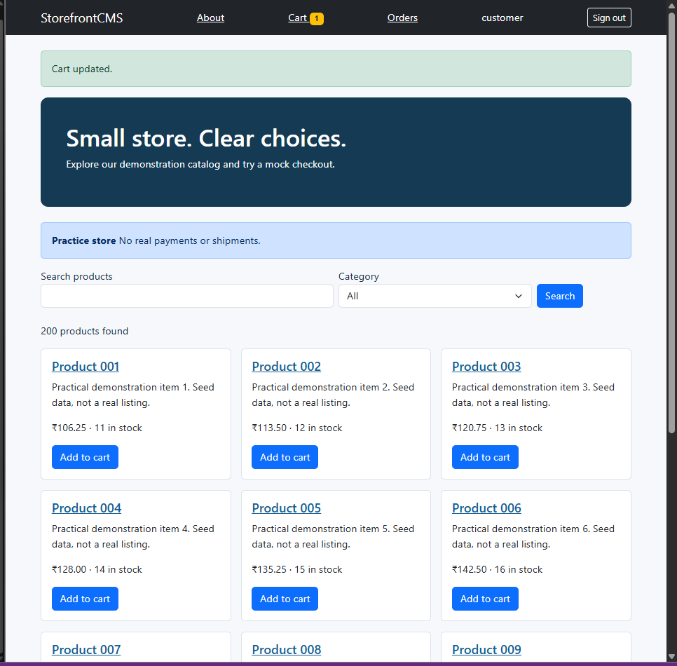](docs/screenshots/01-catalog.png) | [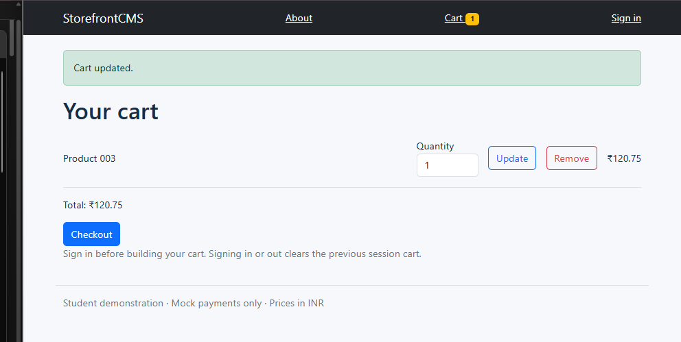](docs/screenshots/02-cart.png) |
| **Catalog:** search, category selection, paginated products | **Cart:** quantity, total, update/remove, navigation badge |

| Completed order | Customer order history |
|:--:|:--:|
| [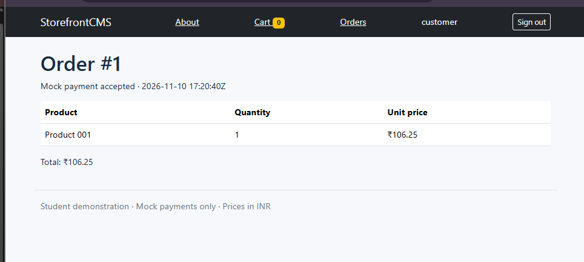](docs/screenshots/03-order-confirmation.png) | [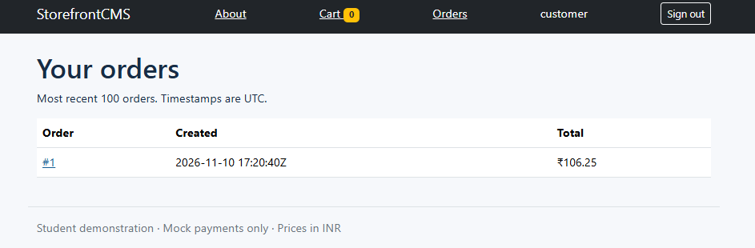](docs/screenshots/04-order-history.png) |
| **Checkout:** mock payment and order detail | **Orders:** order #1 persisted and shown to customer |

| CMS version history | Published CMS banner |
|:--:|:--:|
| [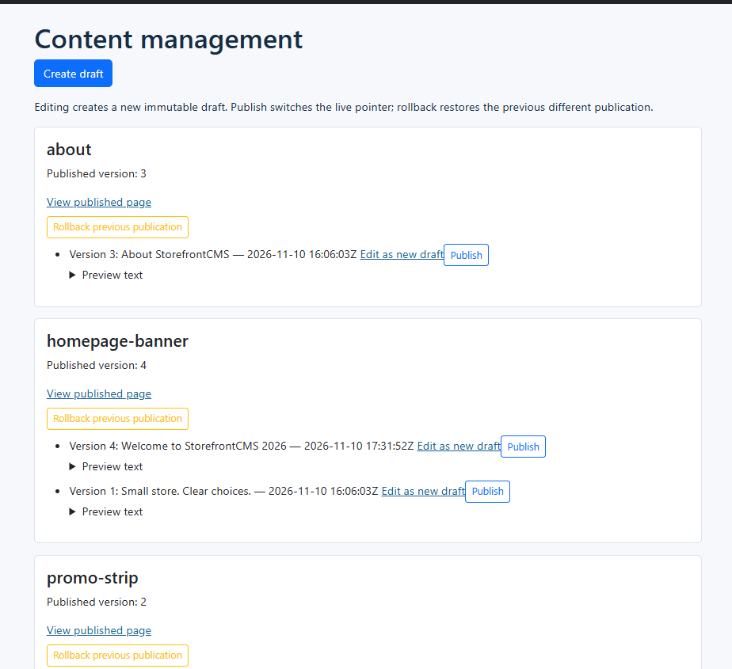](docs/screenshots/05-cms-versions.png) | [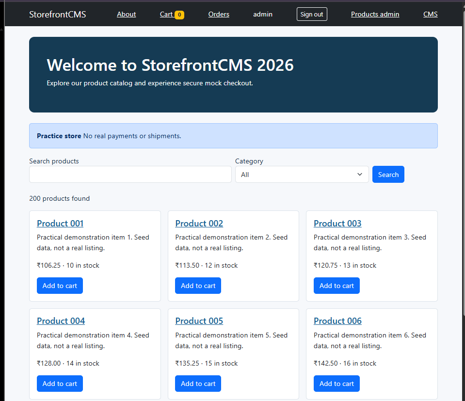](docs/screenshots/06-published-banner.png) |
| **Admin CMS:** published version 4 with prior version retained | **Publish:** new banner appears on the storefront |

| Rollback restored the original banner | Admin product editor |
|:--:|:--:|
| [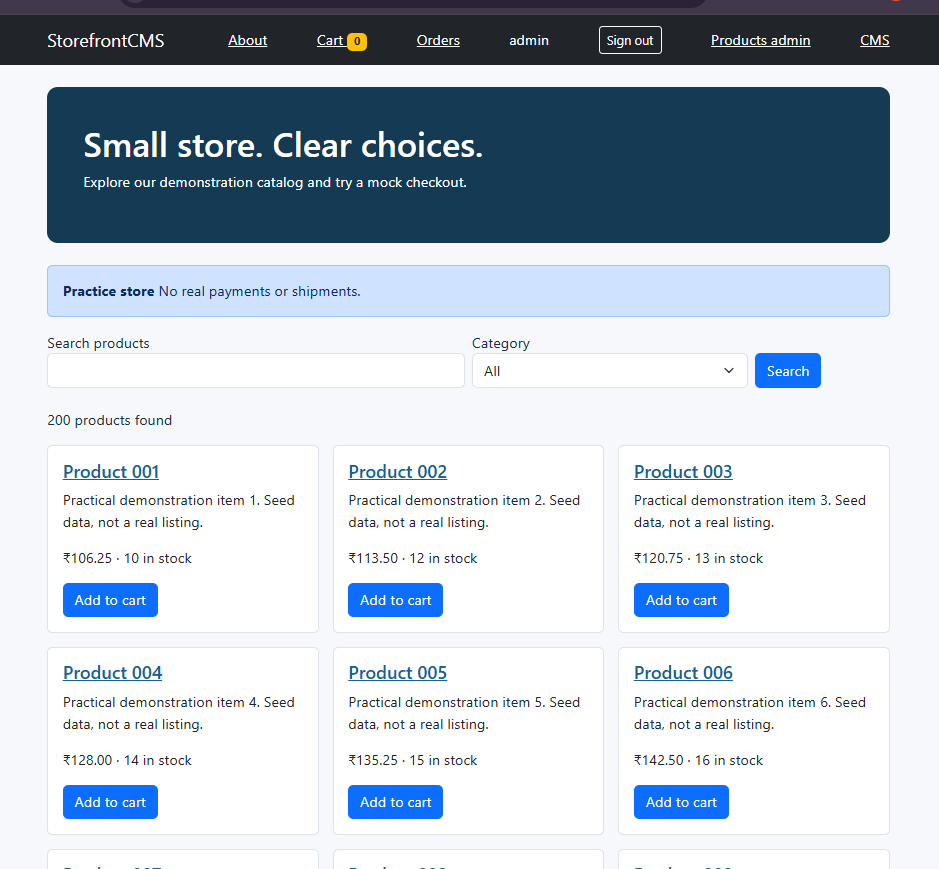](docs/screenshots/07-banner-rollback.png) | [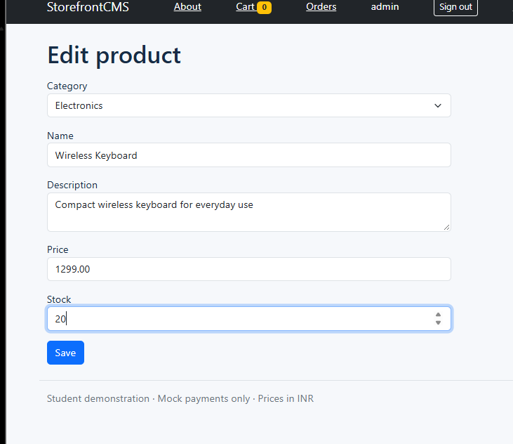](docs/screenshots/08-product-editor.png) |
| **Rollback:** storefront shows original published banner | **Products:** edit category, description, price, and inventory |

| Deactivated product hidden | SQL indexing benchmark |
|:--:|:--:|
| [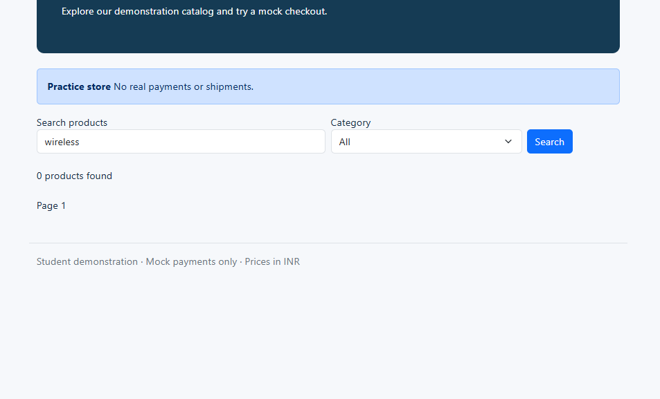](docs/screenshots/09-search-deactivation.png) | [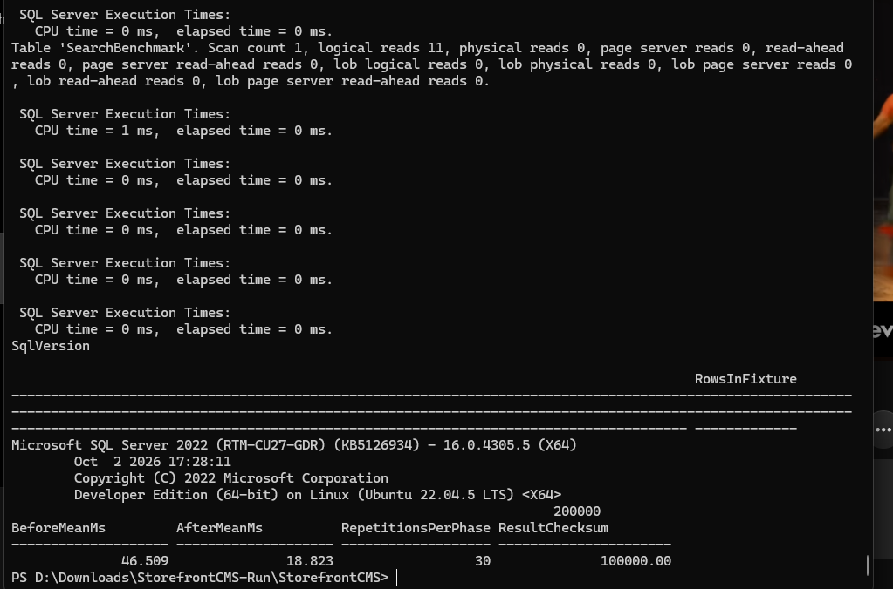](docs/screenshots/10-benchmark.png) |
| **Deactivation:** `wireless` search now finds zero active products | **Benchmark:** 30 samples/phase on 200,000 synthetic rows |

## What it does

| Area | Behavior | Main implementation |
|---|---|---|
| **Catalog** | Browse, filter by category, substring search, product details and 12-item pages | MVC/Razor and `dbo.ProductSearch` |
| **Cart** | Add, change quantity, remove without full-page navigation | jQuery AJAX + JSON + anti-forgery token |
| **Checkout** | Mock payment, atomic order creation, stock checks, order history | C# service + `dbo.PlaceOrder` transaction |
| **Admin products** | Create, edit and deactivate products | Validated admin MVC forms + SQL |
| **CMS** | Draft immutable versions, publish, restore earlier publication | SQL procedures, publication history, memory-cache invalidation |
| **Operations** | Correlation IDs, structured logging, database health endpoint, incident diagnosis | `ILogger`, `/health`, [runbook](docs/RUNBOOK.md) |

This project targets **C#, ASP.NET Core MVC, Razor, Bootstrap 5, JavaScript/jQuery, AJAX/JSON, SQL Server, T-SQL procedures, and CMS/ecommerce workflows**. It does **not** claim to implement legacy ASP.NET Web Forms, TFS integration, or a full digital-experience platform.

## Run locally on Windows 11

### Requirements

- Docker Desktop installed, running, and configured for **Linux containers**; Docker/WSL2 should have enough memory for SQL Server (prefer at least **4 GB** available).
- **PowerShell 7** (`pwsh`) for the included setup and SQL scripts. The built-in Windows PowerShell 5.1 is not the same executable.
- Internet access on first run to download container images and application dependencies.
- Port **8080** (website) and **1433** (SQL Server) available locally.

### Step 1 — Open the project folder

Download/extract the ZIP; open PowerShell from the folder containing `docker-compose.yml`. For the demonstrated Windows location:

```powershell
cd "D:\Downloads\StorefrontCMS-Run\StorefrontCMS"
```

If you extracted elsewhere, use that directory instead. Confirm the tools:

```powershell
pwsh --version
docker compose version
docker info --format '{{.OSType}}'    # expected: linux
```

If PowerShell 7 is missing, install it and reopen your terminal:

```powershell
winget install --id Microsoft.PowerShell --source winget
```

### Step 2 — Generate local credentials (first run only)

```powershell
pwsh -File scripts/setup.ps1
Test-Path .env
```

Expected: `True`. The script creates `.env` with an SQL Server password plus separate customer/admin demo passwords. **Never commit or screenshot these values.** If `.env` already exists, **skip the setup command**; it intentionally refuses to overwrite your credentials.

### Step 3 — Build and start the containers

```powershell
docker compose up --build -d
```

This builds the .NET application, starts SQL Server 2022, runs initial SQL scripts, and starts the website. On initial startup, SQL Server may take longer to become healthy.

### Step 4 — Verify the startup

```powershell
docker compose ps -a
docker compose logs --tail=60 init
docker compose logs --tail=50 app
```

| Service | Expected state |
|---|---|
| `db` | `Up (healthy)` |
| `init` | `Exited (0)` — normal, one-time initialization |
| `app` | `Up`, listening on HTTP port 8080 |

The initialization log should report **200 products** inserted into the fresh sample database.

### Step 5 — Open the site

- **Homepage:** http://localhost:8080
- **Health check:** http://localhost:8080/health
- **Sign in:** http://localhost:8080/Account/Login
- **Admin products:** http://localhost:8080/Admin/Products (admin login required)
- **Admin CMS:** http://localhost:8080/Admin/Cms (admin login required)

Log in as `customer` or `admin` using the respective password in your **local** `.env` file. Signing in/out clears the existing session cart, so **sign in before adding items**.

To inspect a password locally without sharing it:

```powershell
Select-String -Path .env -Pattern '^CUSTOMER_PASSWORD='
# For admin login, use '^ADMIN_PASSWORD=' instead.
```

### Step 6 — Stop or restart

```powershell
docker compose down         # stop while keeping database volumes
docker compose up -d        # restart without rebuilding
```

**Do not run `docker compose down -v` casually:** it deletes the local SQL database **and** key volumes. The demo initialization is not a migration system and cannot automatically repair a partially initialized database.

**Using Linux or WSL?** Replace the first-run setup with `bash scripts/setup.sh` and use `bash scripts/sql.sh order-tests` / `bash scripts/sql.sh benchmark` for SQL checks. Docker commands otherwise stay the same.

## Architecture

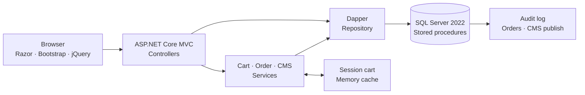

The architecture is deliberately modest: a single application and one SQL database. Controllers handle HTTP, services enforce checkout/CMS rules, Dapper binds inputs to stored procedures, and the database owns transactional data changes.

<details>
<summary><strong>Entity relationships</strong></summary>

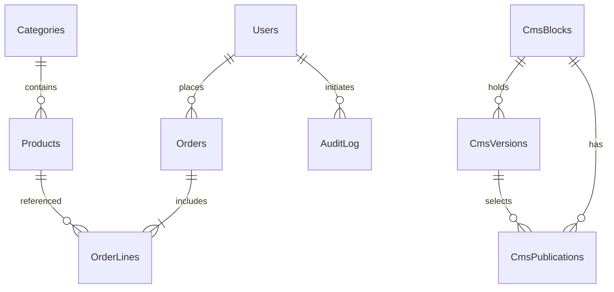

</details>

### Why the database matters

**Checkout:** `PlaceOrder` takes product update locks in a consistent ID order, validates quantity/stock, saves the order and order lines, decrements stock, and writes an audit record **in one transaction**. Insufficient stock rejects the order without partial inventory changes. An idempotency key prevents a successful request from inserting a duplicate order.

**CMS:** Editing creates an immutable draft. Publishing selects the live version, appends publication/audit history, and invalidates the app's local CMS cache. Rollback restores the most recent **different** publication; it is not a destructive undo or a stepwise rewind through every historical version.

**Search:** Customer-facing product search currently uses parameterized `LIKE '%term%'` substring matching and pagination. Its leading wildcard is **not** accelerated by the synthetic benchmark's prefix-lookup index.

## Verification and results

The table distinguishes **observed local results** from static features in the source. The browser, SQL and Docker checks below were performed on the user's Windows/Docker environment on **10 November 2026**; screenshots and uploaded logs were reviewed. The original authoring environment had separate build/syntax checks documented in [EXECUTION_REPORT.md](EXECUTION_REPORT.md).

| Verification | Result and evidence |
|---|---|
| Docker Compose | `db` healthy, `init` exited 0, `app` running on `127.0.0.1:8080` |
| Seeded products | 200 products shown; initialization log reported `(200 rows affected)` |
| Customer flow | Logged in, cart updated, mock order **#1** placed for Product 001, order history displayed |
| Inventory | Product 001 stock **11 → 10** after quantity-1 checkout |
| Database order tests | Script printed **PASS** for stock, pricing, audit, idempotency, rollback, invalid quantity, empty cart |
| Admin CMS | Version 4 published to homepage; rollback restored original `Small store. Clear choices.` text |
| Product admin | Wireless Keyboard created; editor used for price/stock changes; deactivated product no longer appeared in `wireless` search |
| xUnit | **14 passed** in original .NET Release build report; rerun locally if needed |
| Search index benchmark | **46.509 ms → 18.823 ms** mean, **30 measurements per phase**, **200,000 synthetic rows** |

### Measured SQL Server benchmark

| Metric | Without covering index | With covering index |
|---|---:|---:|
| Mean elapsed time | **46.509 ms** | **18.823 ms** |
| Repetitions | 30 | 30 |
| Representative logical reads in query log | 12,403 | 11 |

That is a **59.53% reduction** in mean elapsed time (**2.47× speedup**) in the isolated **category/prefix synthetic workload**. The index build itself is excluded from these timings; this does **not** establish a 59.53% improvement to the application's substring search or production traffic. Results depend on hardware, load, caching, and execution plans.

Run the database tests and capture a fresh local benchmark:

```powershell
pwsh -File scripts/sql.ps1 order-tests
pwsh -File scripts/sql.ps1 benchmark | Tee-Object benchmark-results.txt
```

`benchmark-results.txt` is ignored by Git because it can be large. See the [local verification notes](docs/LOCAL_VERIFICATION.md) for a concise evidence log and [the benchmark screenshot](docs/screenshots/10-benchmark.png) for this run's numbers.

### Reproduce unit tests (optional)

The Dockerfile runs unit tests while building. With the .NET 10 SDK installed locally, you can run:

```powershell
dotnet test StorefrontCMS.slnx -c Release
```

The 14 xUnit tests exercise service logic with mocked repositories; the SQL order script is the **separate integration test**. Do not describe the unit tests as SQL integration tests.

## Security and production support

| Protection | Implementation / limitation |
|---|---|
| Parameterized SQL | Dapper parameters and fixed stored-procedure names; LIKE input escaped |
| CSRF | MVC anti-forgery validation; AJAX mutations send `X-CSRF-TOKEN` |
| Output encoding | Razor encodes CMS/product text; client messages use `.text()` |
| Server validation | MVC annotations, service bounds, SQL constraints and stock checks |
| Admin access | Cookie authentication with role checks |
| Sensitive settings | Generated `.env` excluded from Git and build context |
| Observability | Request correlation ID, structured JSON logs, `/health` database probe |

Use [docs/RUNBOOK.md](docs/RUNBOOK.md) for diagnostics and SQL queries for **insufficient stock**, **stale published content**, and **slow product searches**. It is a documented *simulation-oriented* support guide, not a claim of handling real production incidents.

**Important demo limitations:** no HTTPS in the local container, SQL `sa` used by the app, self-signed DB TLS, single-process session/cart/cache, no real payment, MFA, account registration, migration framework, or multi-instance scaling. The data-protection key encryption warning in logs is not a fatal demo error, but a production deployment would require stronger key protection and least-privilege access. See the [interview notes](INTERVIEW_NOTES.md) for tradeoffs.

## Repository layout

```text
StorefrontCMS/
├── src/StorefrontCMS/        # MVC app, Razor views, services, Dapper, CSS/JS
├── database/                 # schema, seed, procedures, order tests, benchmark
├── tests/                    # xUnit service tests
├── tools/                    # SQL syntax checker
├── scripts/                  # credential setup and SQL execution helpers
├── docs/
│   ├── screenshots/          # real browser and benchmark captures
│   ├── RUNBOOK.md            # troubleshooting with SQL diagnostics
│   └── LOCAL_VERIFICATION.md # observed local test evidence
├── docker-compose.yml
├── Dockerfile
├── StorefrontCMS.slnx
├── INTERVIEW_NOTES.md
└── README.md
```

## Source control and interview walkthrough

A sensible explanation order: **`PlaceOrder` transaction → SQL schema/indexes → service layer → controllers → Razor/jQuery → CMS publication flow**. If asked about testing, distinguish mocked unit tests, SQL procedure tests, and your manually verified browser flows. If asked what to change for real production, start with least-privilege database access, HTTPS/secret management, migration/versioning, distributed session/cache, and automated browser/concurrency testing.

Suggested incremental commit messages: `feat: add transactional checkout`, `feat: publish versioned CMS content`, `test: cover order rejection`, `docs: add measured SQL benchmark`. They are examples, not a claim that those commits or code reviews occurred.

## License

MIT; see [LICENSE](LICENSE). Frontend libraries retain their own licenses.
